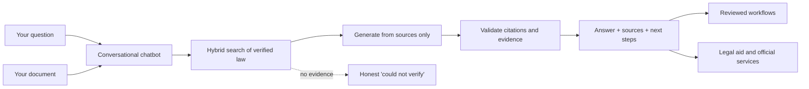

# VidhiVerse AI

**Understand Law. Access Justice.**

AI-powered conversational legal information assistant for India.

VidhiVerse AI is an AI-powered conversational legal assistant that helps Indian citizens understand their legal rights and responsibilities, simplify legal documents, discover relevant laws and judgments, and identify appropriate next steps through reliable, source-backed explanations.

Built for the AI for Lawyers Hackathon 2026, **PS-02 – Access to Justice: Legal Information Chatbot**.

> **Status: documentation only.** No application code exists yet, and no cloud infrastructure has been created.
>
> **Independently developed.** Not affiliated with, or endorsed by, the Government of India, the Department of Justice or any government service, including NYAYA-SETU. It does not replace lawyers or government legal services. VidhiVerse AI is a working product name. Its trademark, domain and brand availability have not been verified ([D-17](docs/review/decision-register.md)).
>
> General legal information only, not legal advice.

## What it will do

Ask a legal question in everyday language and have a conversation. The chatbot is the product. These capabilities support it:

| Capability | Priority | What it adds |
|---|---|---|
| **Intelligent Legal Conversation** | P0 | Follow-ups, simple explanations, relevant provisions and judgments, verified citations and official links |
| **AI Legal Document Understanding** | P0 | Ask about your notice or agreement; every finding shows an exact quotation and page |
| **Citation-Backed Legal Research** | P0 | Acts, amendments and judgments; current and historical comparison; never fabricated |
| **Guided Legal Assistance** | P1 | Your situation matched to legally reviewed workflows and official authorities |
| **Legal Aid Navigation** | P1 | Free legal aid, Legal Services Authorities, links to NALSA and Tele-Law |
| **Personal Legal Matter Companion** | P1, optional | Basic document organisation, timelines, user-confirmed reminders |

English is the complete P0 experience. Hindi and Telugu are P1, subject to time, API availability and language-quality validation. Additional Indian languages are P2. If it cannot verify something, it says so and does not invent it.

## Stack

React, TypeScript, Vite, Material UI, Redux Toolkit, PDF.js · Python, FastAPI · SQLite with sqlite-vec + FTS5 (single file, no server, no Docker) · open multilingual embeddings · configurable LLM · PyMuPDF, Tesseract · SerpApi for admin discovery only. Local-first and zero-cost-first.

## Documentation

**[Documentation index](docs/README.md)**. Start with the [canonical reference](docs/00-canonical-reference.md).

| Need | Go to |
|---|---|
| Product scope | [PRD](docs/product/03-product-requirements-document.md), [Feature specifications](docs/product/07-feature-specifications.md) |
| Architecture | [System architecture](docs/technical/08-system-architecture.md), [RAG](docs/technical/09-rag-architecture.md) |
| Data | [Database schema](docs/technical/11-database-schema.md), [Legal ingestion](docs/technical/10-legal-data-ingestion.md) |
| API | [API specification](docs/technical/12-api-specification.md) |
| Setup | [Local setup](docs/infrastructure/18-local-development-setup.md), [Installation](docs/infrastructure/21-installation-guide.md) |
| Plan | [Roadmap](docs/hackathon/29-development-roadmap.md), [Implementation checklist](docs/review/implementation-checklist.md) |
| Open questions | [Decision register](docs/review/decision-register.md) |
| Risks | [Limitations and risks](docs/hackathon/30-known-limitations-and-risks.md) |

## Local URLs (once implemented)

| Service | URL |
|---|---|
| Frontend | http://localhost:5173 |
| Backend | http://localhost:8000 |
| Swagger | http://localhost:8000/docs |
| Database | `storage/vidhiverse.db` (a file, not a URL) |

Never commit secrets. See [environment variables](docs/infrastructure/20-environment-variables.md).
