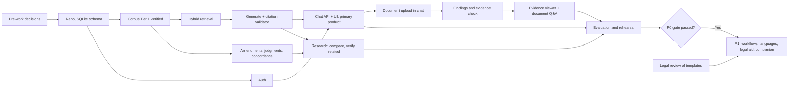

# 29 – Development Roadmap

Four weeks. **The conversational chatbot works end to end by the end of Week 2. P1 begins only after the P0 gate passes.** The hackathon date and team size are unknown ([D-03](../review/decision-register.md)).

## Dependencies

## Pre-work (before Week 1)

Close the blocking decisions: D-01 shortlist, D-03, D-04, D-05, D-18 (D-13 is closed — no Docker needed). Appoint the legal reviewer. Run the preliminary VidhiVerse AI availability search (D-17).

## Week 1 – Foundation

**Deliverable:** running local application and searchable legal knowledge base.

| Task | Done when |
|---|---|
| Repository, tooling, secret scan; Vite, MUI, routes, i18n; FastAPI structure, `ENABLED_LANGUAGES`, `/health` | Shells run at :5173 and :8000 |
| SQLite schema (`sqlite-vec` + FTS5) via `apply_schema.py`; migrations `0001`–`0006` | Survive restart; upgrade from empty |
| Auth: guest, register, login, refresh; isolation harness | Tests pass |
| Ingestion: manifest, parse, QA report, embeddings | Constitution, Consumer Protection Act, BNS, BNSS parsed |
| Chat UI shell | Message list and composer against a stub |

**Milestone M1:** search finds relevant sections, with metadata.

## Week 2 – Conversational chatbot (primary deliverable)

**Deliverable:** working chatbot in English.

| Task | Done when |
|---|---|
| LLM providers and bake-off; `LLM_DATA_POLICY` enforced | D-01 closed |
| Rest of Tier 1; IPC and curated judgments start; SerpApi service, `0008` | QA reports approved |
| Hybrid retrieval, temporal filters, evidence gate | Boundary tests pass; first recall |
| Understanding step, follow-ups, clarification | Q-11 passes |
| Generator, citation validator, repair, section-not-found | All branches tested |
| SSE, answer card, citation cards, feedback, disclaimers | Demo 1 and Demo 5 flows work |
| Input and output safety | Q-10, Q-13 first pass |

**Milestone M2:** Demos 1 and 5 work in English. **This is the hackathon's minimum viable result.**

## Week 3 – Document explainer and research (P0 supporting)

**Deliverable:** all P0 capabilities work from the chat.

| Task | Done when |
|---|---|
| Upload in chat, consent, private storage, deletion; extraction with positions; clause segmentation; `0010` | Security tests pass; clauses match on 5 test documents |
| Findings, evidence check, PDF.js viewer, document Q&A | Unmatched findings dropped by test; Demo 2 passes |
| Amendments for demo Acts, judgment links, concordance for verified pairs; `0009` | Sample audited |
| Research views: search, compare, related, verify; chat suggested actions | Demo 3 passes |
| Privacy controls and retention worker | Deletion tests pass |

**Milestone M3 (P0 gate):** Demos 1, 2, 3 and 5 pass.

## Week 4 – Quality, then P1 if the gate passed

**First priority, and never skipped (at least 3 days):** full evaluation, top fixes, legal review, security, responsive and accessibility checks, snapshot and restore, slides, video, three clean rehearsals.

**P1 work, in order, only if M3 passed on time and with people free:**

| Order | Item | Time-box | Condition |
|---|---|---:|---|
| 1 | Three legally reviewed workflows; `0013` (needs `0012`) | 4 days | Review already under way since Week 2; **no sign-off, no ship** |
| 2 | Hindi and Telugu (provisional, D-25) | 4 days | Time, API availability, and language-quality validation with a native reviewer |
| 3 | Legal Aid Navigator; `0011` | 3 days | Records verified |
| 4 | Basic case companion; `0012` | 2 days | Everything above is done. **It must not delay the chatbot.** |

Feature freeze is 2 days before the event.

**Milestone M4:** demo run three times clean.

## Capacity check

**[ASSUMPTION]** Rough person-day estimates, to re-check when the team is known.

| P0 work | Person-days |
|---|---:|
| Foundation, auth, tooling | 8 |
| Corpus, verification, demo-scope amendments, judgments, concordance | 12 |
| RAG, validator, safety | 12 |
| Chat API and UI | 7 |
| Document explainer | 12 |
| Research | 7 |
| Evaluation, legal review support, security, demo | 10 |
| **P0 total** | **68** |

| P1 work | Person-days |
|---|---:|
| Workflows, excluding reviewer's time | 7 |
| Hindi and Telugu | 7 |
| Legal Aid Navigator | 4 |
| Companion | 5 |
| **P1 total** | **23** |

| Team (20 working days each) | Capacity | Verdict |
|---|---:|---|
| 4 people | 80 | **P0 achievable**, with about 12 days of margin for one or two P1 items |
| 3 people | 60 | **Tight:** P0 only with cuts 1–4 below; no P1 |
| 2 people or fewer | 40 or fewer | **Not achievable as written.** Chatbot, validator, safety, plus a narrowed document explainer, with research limited to citation lookup |

The P1 language estimate is not in the committed scope. The full 91 days of P0 and P1 won't fit in four weeks for a team of 4. Expect to deliver P1 selectively.

## Cut order

**Never cut chat, citation validation, evidence checks, safety, security, privacy or required legal review.**

P1 is first to go, in reverse: companion, Legal Aid, languages, workflows. Then, within P0 scope:

1. Admin UI polish (use CLI and SQL)
2. Reranker, export
3. OCR (text PDFs only)
4. Research limited to demo Acts and fewer judgment links
5. Plain explanation inside research views (the chat still explains)
6. Fewer finding types, keeping quotes and pages

## Post-hackathon

Brand clearance (D-17), legal assessment, user testing, then the P2 roadmap, deployment evaluation ([24](../infrastructure/24-deployment-guide-future.md)) and SaaS planning ([25](../infrastructure/25-saas-scalability.md)).
