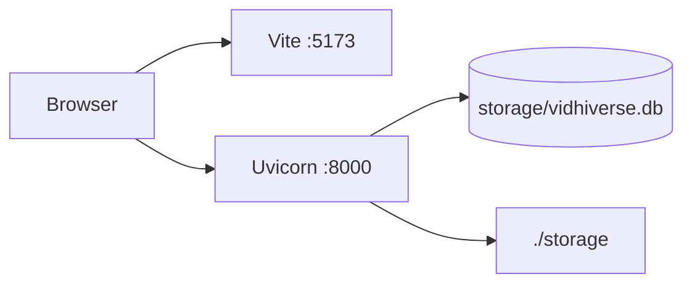

# 18 – Local Development Setup

Everything runs locally. **No cloud account or deployment is created in Phase 1.** The commands below describe the intended setup once the code exists; the repository currently holds documentation only. First-time step-by-step instructions are in [21](21-installation-guide.md).

## 1. Requirements

| Tool | Version | Status on the current machine (2026-10-31) |
|---|---|---|
| Git | Latest | Directory is not yet a repository |
| Python | 3.12 | 3.12.3 found |
| Node.js | 24 | 24.18.0 found |
| Tesseract with `eng`, `hin`, `tel` | 5.x | Not checked |
| Ollama | Optional | Not checked |

Docker is no longer a requirement (L13/D-13/R-21 are closed): the database is a single
SQLite file opened by the backend, not a container ([19](19-docker-configuration.md)).

**Hardware [ASSUMPTION]:** 16 GB RAM and 20 GB free disk. CPU embedding is workable. Running a capable local LLM may need a GPU or more memory, so test before relying on it.

## 2. Local services

| Service | URL | How it runs |
|---|---|---|
| Frontend | http://localhost:5173 | `npm run dev` |
| Backend | http://localhost:8000 | `uvicorn` |
| Swagger | http://localhost:8000/docs | Backend |
| Database | `storage/vidhiverse.db` | A file, opened by the backend process |



## 3. Daily workflow

```bash
python database/schema/apply_schema.py   # once, or after a reset
```

```bash
cd backend && .venv/Scripts/activate && uvicorn app.main:app --reload --host 127.0.0.1 --port 8000
```

```bash
cd frontend && npm run dev
```

On macOS and Linux, the activation script is `.venv/bin/activate`. PowerShell uses `.venv\Scripts\Activate.ps1`.

## 4. Local-first rules

- A local SQLite file, local files, secrets in environment variables. No database server, no Docker.
- External APIs only where needed; each can be disabled.
- No paid cloud services, Kubernetes, or microservices.

## 5. Conventions

| Topic | Rule |
|---|---|
| Git | `main` protected once on GitHub; feature branches; small pull requests |
| Commits | Conventional Commits |
| Python | `ruff`, `mypy`, `pytest` |
| TypeScript | ESLint, Prettier, `strict: true` |
| Pre-commit | Lint, format, `gitleaks` |
| API types | Generate the frontend client types from `openapi.json` |

## 6. Windows notes

- Keep line endings consistent through `.gitattributes`.
- Add Tesseract to `PATH`, or set `TESSERACT_CMD`.

## 7. Troubleshooting

| Symptom | Likely cause | Fix |
|---|---|---|
| `no such module: vec0` | `sqlite-vec` not loaded on this connection | Confirm the engine's `connect` event calls `sqlite_vec.load(conn)` before use |
| `database is locked` | Two processes writing at once | Expected under concurrent writes on SQLite; keep write transactions short, retry, or move to a managed Postgres if this becomes frequent ([22 §5](22-database-migrations.md#5-scaling-beyond-the-mvp)) |
| First answer is very slow | Embedding model load or download | Pre-download with `scripts/download_models.py` |
| CORS errors | Origin mismatch | `CORS_ORIGINS` must include `http://localhost:5173` |
| Refresh fails | Mixed `localhost` and `127.0.0.1` | Use `localhost` consistently in the browser |
| OCR failure | Language data missing | Install `hin`, `tel` packs |
