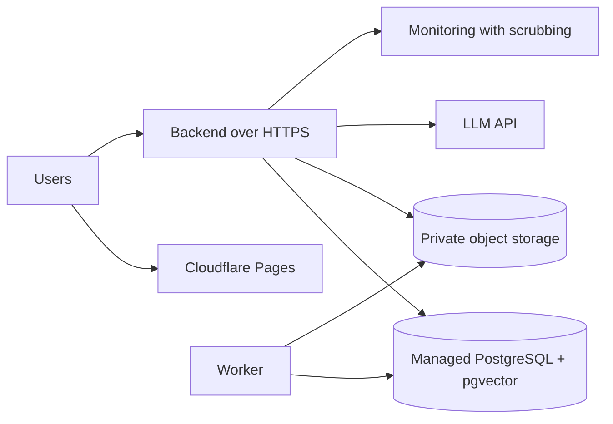

# 24 – Future Deployment Guide

> **Future phase only.** Do not create cloud accounts or deploy anything in Phase 1. This document prepares architecture and decisions. Re-check every limit before acting, as free tiers change.

## 1. Candidate free-tier stack

| Component | Candidate | Fit |
|---|---|---|
| Frontend | Cloudflare Pages | Good for a static build |
| Backend | Render Free | Demo only |
| Database, auth, storage | Supabase Free | Prototype only |
| Source | GitHub Free | Good |
| Errors | Sentry Free | Scrub content before sending |

## 2. Limits to document

| Item | Render Free | Supabase Free | Cloudflare Pages | Sentry Free |
|---|---|---|---|---|
| Inactivity | Spins down after 15 min **[VERIFIED: L5]** | Pauses after 1 week **[VERIFIED: L4]** | Check | n/a |
| Cold start | Up to about 1 min, plus our model load **[L5]** | Resume needed | Check | n/a |
| Storage | Local filesystem lost **[L5]** | 500 MB DB, 1 GB files **[L4]** | Check | n/a |
| Hours or bandwidth | 750 instance hours a month **[L5]** | 5 GB egress reported **[L4, check]** | Check | Check event quota |
| Backups | n/a | No automatic backups **[L4]** | n/a | n/a |
| Memory | Check; `torch` plus model may not fit | n/a | n/a | n/a |
| Commercial use, retention, API charges | Check | Check | Check | Check |

## 3. What breaks moving to free hosting

| Issue | Why | Options |
|---|---|---|
| Embedding model in backend process | Memory, cold start | ONNX runtime or hosted embedding API, keeping the same model family to avoid re-embedding |
| In-process worker | Sleeps with the service | Separate paid worker, or managed queue |
| Local files | Ephemeral | `StorageProvider` for object storage |
| Corpus size | May exceed 500 MB (see [11 §6](../technical/11-database-schema.md)) | Paid tier, smaller corpus, or halfvec |
| Database engine | The MVP's SQLite file has no multi-instance write path | One-off ETL to managed PostgreSQL + pgvector ([§5](#5-migration-runbook)), not a container swap |
| SSE | Host timeouts | Test; ensure proxy buffering is off |
| In-process rate limit | Multiple instances | Database or Redis-backed |
| Supabase Auth | Different auth model | Keep our JWT auth, or plan a migration |
| PyMuPDF licence | AGPL network-use considerations (R-12) | Commercial licence or replacement |

**Decision rule:** free tier is acceptable for a **public-corpus-only demo**. It is not acceptable for sensitive legal documents or production traffic without a privacy and security assessment. **An expiring or pausing database must never be the permanent production database.**

## 4. Target topology

## 5. Migration runbook

| Step | Task | Check |
|---|---|---|
| 1 | Assess data residency, DPDP, provider terms | Written decision |
| 2 | Provision managed PostgreSQL; install/confirm `pgvector` version | `SELECT extversion` |
| 3 | Run the PostgreSQL-dialect schema (reverse the translation table in [11 §4](../technical/11-database-schema.md#4-ddl)) via Alembic on the empty database | Revision matches |
| 4 | Move corpus only: a one-off ETL script reads `storage/vidhiverse.db` (SQLite) table by table, including the `_vec` virtual tables' raw float vectors, and inserts into the new Postgres tables/`vector` columns. **Do not migrate local test user data.** This is a data transform, not a `pg_restore` — the two engines don't share a dump format. | Row counts, checksums |
| 5 | Build the HNSW index (there was none to rebuild — `vec0` was always brute-force); recall test | Recall unchanged or better |
| 6 | Copy legal originals to object storage; implement provider | Random file checksum |
| 7 | Move environment variables to host's secret manager; generate new secrets | No `.env` files in image |
| 8 | HTTPS, `CORS_ORIGINS`, secure cookies; set frontend API URL | Browser tests |
| 9 | Backups: automated and a restore test | Restore proves it |
| 10 | Logging, monitoring with scrubbing | No content in logs |
| 11 | Rate limiting, abuse controls, spend limits | Load test |
| 12 | Authentication: keep custom unless reassessed | Login, refresh tests |
| 13 | Run evaluation against deployment | Metrics at or above local |
| 14 | Name, terms, privacy notice, legal sign-off | [D-17](../review/decision-register.md), [D-04](../review/decision-register.md) |

**Rollback:** keep previous image and a database snapshot; forward-only schema changes with expand-then-contract.

## 6. Environment changes

`APP_ENV=production`, managed `DATABASE_URL` with TLS, `STORAGE_PROVIDER=s3_compatible` with new variables, new `SECRET_KEY`, `CORS_ORIGINS` set to the real origin, and frontend `VITE_API_BASE_URL`.

## 7. Go-live gates

- Legal and privacy assessment completed, including matter data, workflows and uploaded documents.
- Name decision completed.
- Penetration or security review done.
- Paid plan or proven-safe plan for user data.
- Backup restore tested.
- On-call owner named.
