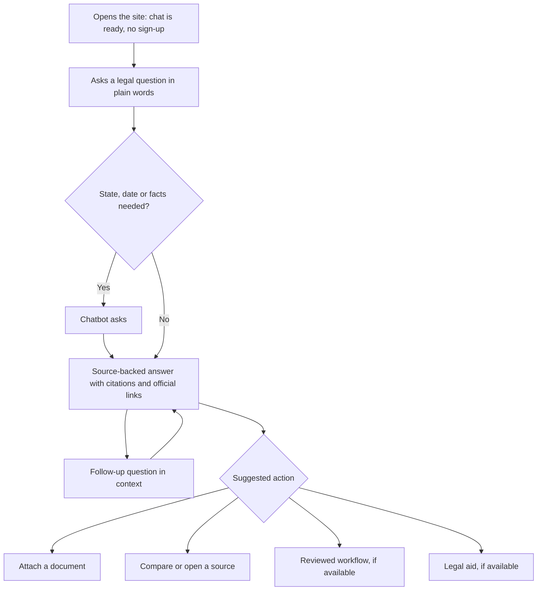
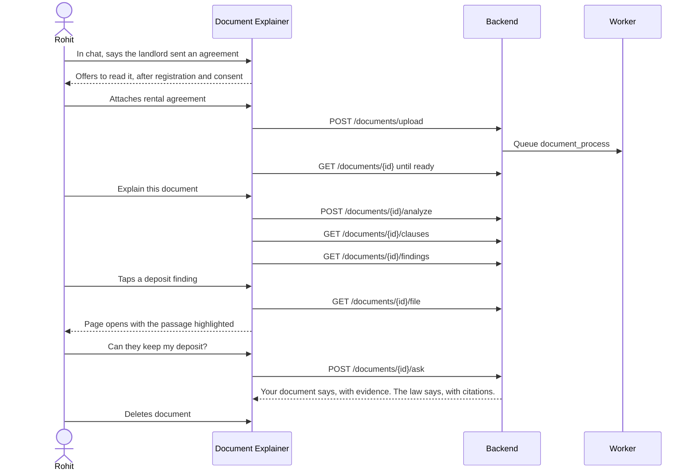
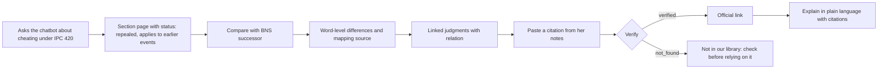
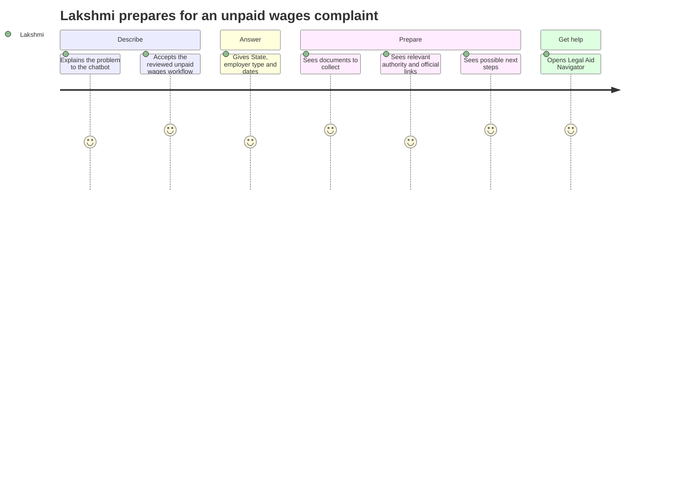
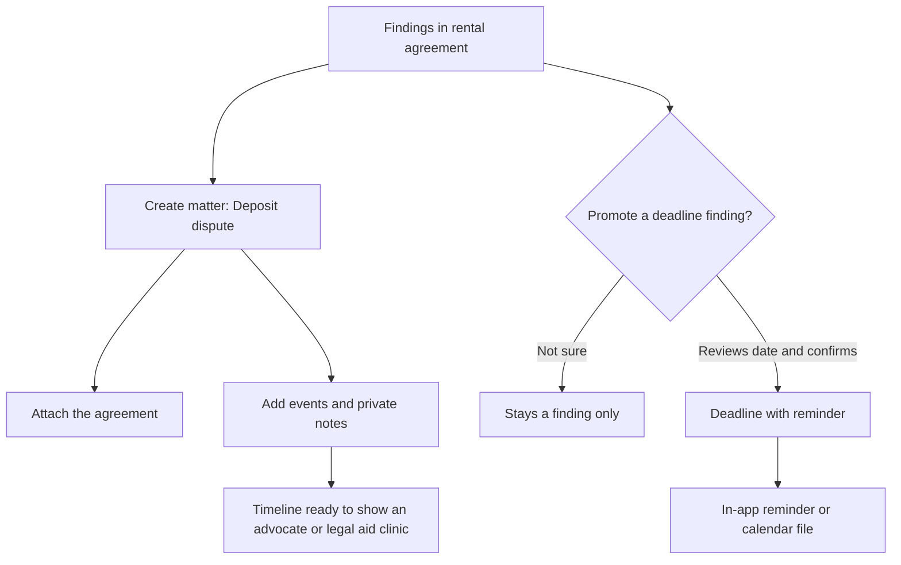
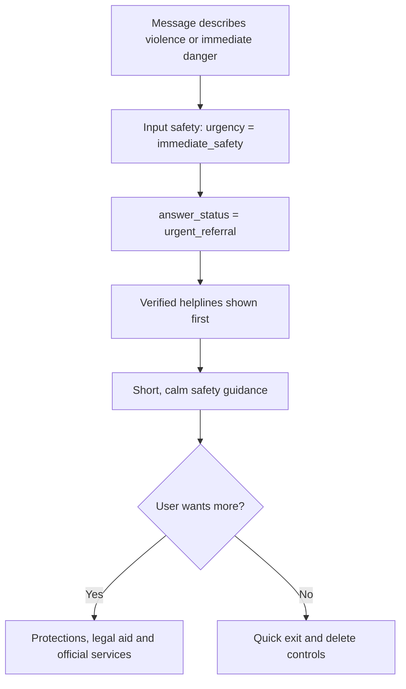
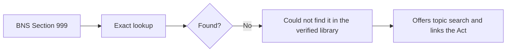

# 04 – User Personas and Journeys

> **[ASSUMPTION]** Illustrative planning personas, not research findings. Validate with real users ([D-15](../review/decision-register.md)).

## 1. Personas

| Persona | Situation | Language and device | Starts in chat, then uses | Design implication |
|---|---|---|---|---|
| **Rohit**, tenant, Lucknow | Rental agreement and a deposit dispute | Hindi, Romanized typing, phone | F-DOC, F-CASE | Evidence viewer works on mobile |
| **Lakshmi**, garment worker, Hyderabad | Wages delayed; cannot afford a lawyer | Telugu if delivered, low-cost Android | F-PLAN, F-AID | Light pages |
| **Neha**, law student, Delhi | Mapping IPC to BNS and finding judgments | English, laptop | F-RES | Comparison, citations |
| **Imran**, shop owner, Pune | Customer demands a refund; supplier contract | English and Hindi | F-DOC, F-PLAN | Duties as well as rights |
| **Meera**, paralegal at an NGO | Helps others prepare papers | English, Telugu | F-RES, F-PLAN | Print-friendly checklists |
| **Asha**, homemaker, rural Andhra Pradesh | Experiencing domestic violence; shared phone | Telugu | Safety, F-AID | Helplines first; quick exit; no matter required |
| **Admin**, project team | Maintains corpus and credits | English | F-ADMIN | Verification workflow |

All journeys **start in the chatbot**. Other screens open from it, and return to it. Journeys using P1 features apply only if those are delivered.

## 1a. Journey: conversation (primary)

## 2. Journey: document understanding (Rohit)

## 3. Journey: research (Neha)

## 4. Journey: guided assistance (Lakshmi, P1)

## 5. Journey: matter companion (Rohit, optional P1)

## 6. Journey: urgent safety (Asha)

The safety path overrides any workflow. Helplines come from verified `legal_aid_resources` records and do not depend on the LLM. If none is verified, the screen says to contact local emergency services and does not invent a number.

## 7. Journey: invented section or citation

## 8. Accessibility commitments

- Everyday language, with each legal term explained once.
- At least 16 px text on mobile; Telugu and Devanagari fonts tested.
- A single visible next action on each screen.
- Quick exit on sensitive flows ([13](../technical/13-frontend-architecture.md)).
