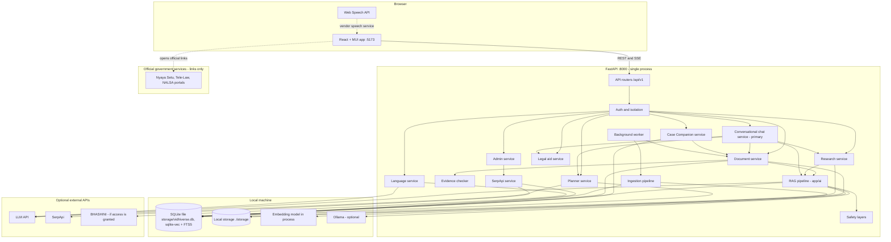
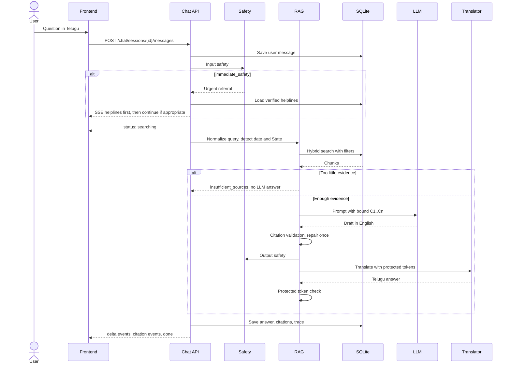

# 08 – System Architecture

All content is **[PROPOSED]** unless labelled otherwise.

## 1. Principles

0. **The chatbot is primary:** the chat service orchestrates the experience. Document, research, workflow and matter services support it and are reachable from a conversation.
1. **Local first:** one laptop runs everything except optional external APIs.
2. **Modular monolith:** no microservices, Kubernetes or Redis. Clear internal module boundaries keep later extraction possible.
3. **Providers behind interfaces:** LLM, embeddings, translation, speech and storage can each be swapped by configuration.
4. **Trust over speed:** nothing legal reaches the user before validation.
5. **Data sovereignty by default:** user content goes to external services only where necessary and disclosed.
6. **Deterministic where possible:** evidence checks, citation verification, comparison and workflow rules involve no LLM.
7. **Connect, don't recreate:** government services are linked. Integration needs official documentation and permission.

## 2. System diagram

## 3. Components

| Component | Responsibility | Does not |
|---|---|---|
| API routers | HTTP, validation, auth dependency, serialization | Contain business logic |
| Conversational chat service (primary) | Sessions, messages, routing by intent to supporting services, suggested actions, SSE | Call LLM directly |
| RAG pipeline | Understand, retrieve, generate, validate | Touch HTTP |
| Safety | Input checks, output checks, urgent referral | Depend on LLM for urgent referral display |
| Document service | Upload, status, clauses, findings, summary, Q&A, authorised file access | Serve files from a public directory |
| Evidence checker | Confirms each quote against extracted text; records offsets | Call any LLM |
| Research service | Search, amendments, related authorities, comparison, citation verification, explanation | Compare or verify by LLM |
| Planner service | Matches situations, evaluates declarative rules, tracks checklists | Let the LLM add steps |
| Case Companion service | Matters, timelines, deadlines, reminders, notes | Send notes to an LLM without an explicit action |
| Language service | Detection, translation, protected tokens | Translate source legal text as if authoritative |
| SerpApi service | Budgeted discovery | Provide citations |
| Worker | Polls `ingestion_jobs` for documents and legal ingestion | Require Redis or Celery |

## 4. Chat request lifecycle

A message with `document_id` also searches that document, and intent routing can add research, workflow or legal aid suggestions. Supporting screens use their own routes, and share the same retrieval, validation and safety modules.

The Telugu path shown applies once F-LANG is enabled. For English, translation steps pass through.

## 5. Data flows and external disclosure

| Data | Local | Sent outside | Control |
|---|---|---|---|
| Legal corpus | Yes | Fragments go to LLM | Public material |
| User question | Yes | LLM and, if selected, translator after redaction | Redaction ([17](17-ai-safety-and-security.md)) |
| Uploaded document | Yes | Only relevant chunks to an LLM with `LLM_ALLOW_USER_DOCUMENTS=true`; otherwise feature requires a local LLM | Explicit consent |
| Voice (stretch) | Browser | Possibly browser vendor | Notice before use |
| Matter notes, timelines | Yes | Nothing by default | Explicit user action |
| Workflow answers | Yes | Situation text for matching, after redaction | Rule evaluation is local |
| SerpApi queries | Yes | Admin-authored topic terms only | Never user text |

## 6. Module dependencies

Dependencies flow one way: `api → services → ai / repositories → models`. `ai/` never imports `api/`. Provider implementations are selected in `core/container.py` from settings.

## 7. Key trade-offs

| Decision | Why | Cost | Revisit when |
|---|---|---|---|
| Embedding model in process | No extra service | Slower start, more memory | Moving to a small cloud instance ([24](../infrastructure/24-deployment-guide-future.md)) |
| Buffered, validated answer | Trust | Slower visible text | Sentence-level validation matures |
| Generate in English, then translate | One validation path | Extra latency, translation risk | Evaluation shows direct generation is better |
| In-process worker | Simple | One process does all work | Sustained concurrency |
| SQLite + sqlite-vec + FTS5 | One datastore, no server/Docker, free at any corpus size the MVP reaches | Weaker write concurrency than a server; `vec0` is brute-force, not an ANN index | Multi-instance production, or a corpus too large for brute-force vector scan (see [11 §6](11-database-schema.md#6-capacity-estimate)) — move to managed PostgreSQL + pgvector ([22 §5](../infrastructure/22-database-migrations.md#5-scaling-beyond-the-mvp)) |

## 8. Failure behaviour

| Failure | User sees | System does |
|---|---|---|
| LLM down | "Answer unavailable right now", legal aid links, retrieved sources | `LLM_UNAVAILABLE`, fails over if a second provider is set |
| Translator down | English answer with notice | Logs; `translation_status=failed` |
| Embeddings unavailable | Keyword results only | Marks retrieval degraded; answers are held to stricter evidence |
| Database down | Maintenance message | `/health` reports degraded |
| SerpApi down | Nothing | Admin notice |

## 9. Technical dependencies

| Item | Licence or terms to check |
|---|---|
| FastAPI, SQLAlchemy, Alembic, React, MUI core, Redux Toolkit | Open source; confirm during setup |
| PDF.js (`pdfjs-dist`), `react-pdf` | Open source; confirm versions |
| `jsdiff`, `icalendar` | Open source; confirm during setup |
| PyMuPDF | **AGPL or commercial licence. Fine for local MVP. A SaaS may need a commercial licence or an alternative.** See [R-12](../hackathon/30-known-limitations-and-risks.md). |
| Tesseract with `hin`, `tel`, `eng` data | Open source |
| multilingual-e5-small | Check model card (L11) |
| LLMs | Each provider's terms and data use (L9) |
