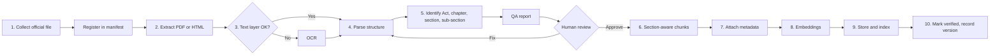

# 10 – Legal Data Ingestion

## 1. Source rules

| Source | Use | Access method **[PROPOSED]** |
|---|---|---|
| [India Code](https://www.indiacode.nic.in/) | Central and State Acts | Manual download first; check site terms before automation |
| [e-Gazette](https://egazette.gov.in/) | Commencement, amendment, notifications | Manual |
| [Supreme Court e-SCR](https://scr.sci.gov.in/) | Judgments | Manual curated set |
| [eCourts](https://ecourts.gov.in/) | Judgments, court information | Manual reference |
| [NALSA](https://nalsa.gov.in/) | Legal aid | Manual verification, stored as records |
| [Department of Justice](https://doj.gov.in/) | Schemes, Tele-Law information | Manual verification |
| [BHASHINI](https://bhashini.gov.in/) | Language services, not a legal source | See [15](15-multilingual-architecture.md) |

**Hard rules:**

- No bypassing CAPTCHAs, rate limits or access controls.
- Blogs and Google snippets are never authority. Discovery links are only leads ([16](16-serpapi-integration.md)).
- Original text is kept unmodified, and the original file is retained with a SHA-256 checksum.
- Terms and rights for each source are recorded in `legal_sources.licence_note`. The review has not yet been done ([D-08](../review/decision-register.md)).

> We have not verified that any of these sites offers an API. This package specifies none.

## 2. Corpus plan

**Tier 1 – required for P0 and demos**

| Instrument | Why | Note |
|---|---|---|
| Constitution of India | Demo 1, rights | Prefer the current official edition |
| Bharatiya Nyaya Sanhita, 2023 | Criminal law | From 1 July 2024 (L7) |
| Bharatiya Nagarik Suraksha Sanhita, 2023 | Procedure | |
| Bharatiya Sakshya Adhiniyam, 2023 | Evidence | |
| Consumer Protection Act, 2019 | Demo 4 workflow, consumer questions | Include relevant rules on jurisdiction limits |
| **Legal Services Authorities Act, 1987** | Demo 4, F-AID | **Added: absent from brief's list, essential to F-AID** |
| Right to Information Act, 2005 | Common query | Check amendments, including by the DPDP Act |
| Information Technology Act, 2000 | Cyber queries | |
| **Transfer of Property Act, 1882; Registration Act, 1908** | Demo 2 context | Added for rent agreements |

**Tier 2 – P0 quality, historical and vulnerable-group coverage**

| Instrument | Why |
|---|---|
| Indian Penal Code, 1860; Code of Criminal Procedure, 1973; Indian Evidence Act, 1872 | **Demo 3 comparison (P0)**, historical queries, with `valid_to` set from verified commencement |
| Official IPC-to-BNS, CrPC-to-BNSS, Evidence-to-BSA correspondence tables | Seeds `section_concordance`, subject to source verification |
| Protection of Women from Domestic Violence Act, 2005 | Safety flows |
| Sexual Harassment of Women at Workplace Act, 2013 | Employee questions |
| POCSO Act, 2012 | Child protection |
| Dowry Prohibition Act, 1961 | Family |
| Hindu Marriage Act, 1955; Special Marriage Act, 1954 | Family |
| **Code on Wages, 2019; Industrial Relations Code, 2020; Social Security Code, 2020; OSH Code, 2020** | **Employment: in force from 21 Nov 2025 (L14). Older labour Acts must be stored as historical.** |

**Tier 3 – State laws for demo States:** Telangana and Andhra Pradesh tenancy law, then Uttar Pradesh, Delhi, Maharashtra. Exact instruments need research and verification. Do not treat the Model Tenancy Act as binding law unless a State has adopted it.

**Judgments (P0 for F-RES):** about 15 for the P0 gate, growing towards 25–40, landmark Supreme Court decisions chosen by the legal reviewer, each with reviewed `provision_case_links`. Candidates, all to be verified: *Maneka Gandhi v. Union of India*, *Shreya Singhal v. Union of India*, *Hussainara Khatoon v. State of Bihar*, *Vishaka v. State of Rajasthan*, *K.S. Puttaswamy v. Union of India*.

## 3. Pipeline



## 4. Metadata manifest

Each file has an entry in `legal-data/metadata/*.yaml`, reviewed in Git:

```yaml
act_key: consumer-protection-act-2019
short_title: Consumer Protection Act, 2019
act_number: "35 of 2019"
source_type: central_act
jurisdiction_level: central
state_code: null
source_url: "<official page URL>"
document_file: central/consumer-protection-act-2019.pdf
checksum_sha256: "<computed>"
enactment_date: 2019-08-09          # must be checked against official text
commencement:
  date: null                        # fill only from a verified notification
  note: "Different dates for different provisions: check Gazette"
  evidence_url: "<e-Gazette URL>"
amendment_history: []
effective_status: unknown
original_language: en
version_label: "India Code copy retrieved <date>"
last_verified_at: null
verified_by: null
```

| Brief's metadata | Stored in |
|---|---|
| Document title, source URL, original language, version information | `legal_sources` |
| Act name, enactment, commencement, amendment history, effective status | `legal_acts` |
| Section number, version | `legal_sections` |
| Jurisdiction | All three levels, denormalized on `legal_chunks` |
| Last verified date | `legal_sources`, `legal_acts`, `legal_sections` |

## 5. Structure parser

- Rules first, with Act-family patterns such as `^\d+[A-Z]*\.\s` for sections and `^CHAPTER [IVXLC]+`, and Constitution patterns for Articles, Parts and Schedules.
- Handles marginal notes, provisos, explanations, illustrations, footnotes with amendment notes, and inserted sections such as `66A`.
- **QA report per Act:** expected count versus parsed (BNS: 358, BNSS: 531, BSA: 170, from memory; confirm); gaps in the sequence; duplicates; oversize; OCR confidence.
- Failures go to a correction file (`legal-data/metadata/corrections/*.yaml`). Originals are never edited.

## 6. Chunking

| Rule | Value |
|---|---|
| Unit | One section is one chunk when it is at most 450 tokens |
| Long sections | Split on sub-section boundaries, then clause; never mid-sentence |
| Overlap | None between sub-sections; 40 tokens for fallback splits |
| Header | Act, chapter, section heading in each chunk |
| Provisos and explanations | Stay with parent |
| Judgments | Paragraph-window chunks, 350 tokens, with paragraph numbers |

The e5-small sequence limit is about 512 tokens (to be confirmed on the model card).

## 7. Amendment and commencement validation

This is a **manual-first, evidence-based** process. An Act cannot be marked `verified` without completing it.

| Check | Evidence | Stored |
|---|---|---|
| Enactment date | Official Act text | `legal_acts.enactment_date` |
| Commencement | Gazette notification | `commencement_date`, `commencement_note`, `amendment_history` evidence |
| Partial commencement | Notification exceptions, e.g., L7 | `effective_status = partially_in_force`; affected section's own status |
| Amendment | Amending Act plus India Code footnote | New `legal_sections` version; previous one gets `valid_to` and `superseded_version` |
| Repeal | Repealing Act | `repealed_by_act_id`, `repealed_on`; savings noted |
| Two-person check | Second team member, ideally the legal reviewer, for Tier 1 | `audit_logs` |

**Effective date rule:** when a date is uncertain, `effective_status = unknown`, and answers citing it must include a warning.

### Structured amendments

For Tier 1 Acts, each verified amendment becomes a `legal_amendments` row with amending instrument, effect, effective date, notification reference and a Gazette or India Code source. The earlier `amendment_history` JSON stays as a summary. Coverage per Act is shown in the Research UI, so missing history isn't mistaken for none.

### Provision to judgment links

Curated by the data lead and reviewed by the legal reviewer. Use `mentions` when the relationship is doubtful. Do not claim a judgment is still good law. Automated citation extraction may propose links later, but they stay `unverified` until reviewed.

### Workflow content

Templates live in `database/seeds/workflows/*.yaml`, reference verified sections by key, and fail to load if any reference does not resolve. Each has `reviewed_by`, `reviewed_at` and is flagged after 180 days without review.

## 8. Versioning

A new version creates new rows. Old rows and chunks stay, with `valid_to` set. `(act_id, section_number, version_no, language)` is unique. Re-ingesting an identical checksum does nothing. Chunks store a copy of validity fields so retrieval needs no join.

## 9. Operations

```bash
python -m app.ingestion.cli register legal-data/metadata/consumer-protection-act-2019.yaml
python -m app.ingestion.cli parse --act consumer-protection-act-2019 --report
python -m app.ingestion.cli publish --act consumer-protection-act-2019
```

The same operations run from `POST /admin/ingestion-jobs`, with status in `GET /admin/ingestion-status`. Publishing requires the report be approved.

Update discovery: [16](16-serpapi-integration.md) surfaces candidates in `source_updates`; a human confirms them. There is no automatic change to law records.

## 10. Storage layout

```text
legal-data/                 # Git: manifests and corrections. Original files only if rights review allows.
  central/  state/  judgments/  metadata/
storage/                    # Git-ignored
  legal/originals/{source_id}/
  legal/processed/{source_id}/
  users/{user_id}/documents/{document_id}/
  tmp/
```

## 11. Effort estimate

**[ASSUMPTION]** Tier 1 needs about 3–5 person-days of parsing and verification. Amendments, judgment links and concordance need about 4–6 more, and workflow authoring and review about 3–5. Together these are the main schedule risk. Start with the Constitution, Consumer Protection Act, BNS and BNSS for the chatbot, then Transfer of Property Act and IPC for Demos 2 and 3. Tiers 2 and 3 outside these are not required for the P0 gate.
