# 11 – Database Schema

SQLite (one file, opened directly by the backend process — no server, no Docker), with
the `sqlite-vec` extension for vector search and FTS5 for full-text and fuzzy search.
Canonical DDL: [`database/schema/schema.sql`](../../database/schema/schema.sql), applied with
[`database/schema/apply_schema.py`](../../database/schema/apply_schema.py). Migrations:
[22](../infrastructure/22-database-migrations.md). Enum values:
[canonical reference](../00-canonical-reference.md#4-enumerations).

Why SQLite over PostgreSQL+pgvector for this project: the corpus is small (10–20k legal
chunks, [§6](#6-capacity-estimate)), there is a single demo instance, and SQLite removes
Docker and a running server as setup/ops dependencies entirely — the database is a file
in `storage/`. The trade-off, accepted for the MVP: weaker write concurrency than a real
server (fine for one demo instance; would need revisiting for multi-instance production),
and no Row-Level Security — isolation stays enforced only at the repository layer
(every query filters by `user_id`, as already noted below).

## 1. ER diagram

```mermaid
erDiagram
    users ||--|| user_preferences : has
    users ||--o{ refresh_tokens : holds
    users ||--o{ chat_sessions : owns
    chat_sessions ||--o{ chat_messages : contains
    users ||--o{ user_documents : owns
    user_documents ||--o{ document_chunks : split_into
    users ||--o{ feedback : gives
    chat_messages ||--o{ feedback : receives
    chat_messages ||--o{ legal_citations : cites
    legal_sources ||--o{ legal_acts : documents
    legal_sources ||--o{ legal_sections : provides
    legal_sources ||--o{ legal_cases : provides
    legal_sources ||--o{ legal_chunks : provides
    legal_sources ||--o{ source_updates : related_to
    legal_sources ||--o{ ingestion_jobs : processed_by
    legal_acts ||--o{ legal_sections : contains
    legal_sections ||--o{ legal_chunks : split_into
    legal_cases ||--o{ legal_chunks : split_into
    legal_chunks ||--o{ legal_citations : referenced_by
    legal_sections ||--o{ section_concordance : maps
    users ||--o{ audit_logs : acts_in
    users ||--o{ serpapi_usage_logs : triggers
    serpapi_cache ||--o{ serpapi_usage_logs : serves
    legal_aid_authorities ||--o{ legal_aid_resources : offers
    user_documents ||--o{ document_clauses : segmented_into
    user_documents ||--o{ document_findings : yields
    document_clauses ||--o{ document_findings : contains
    legal_acts ||--o{ legal_amendments : changed_by
    legal_sections ||--o{ legal_amendments : affected_by
    legal_sections ||--o{ provision_case_links : linked
    legal_cases ||--o{ provision_case_links : linked
    workflow_templates ||--o{ workflow_runs : instantiated_as
    users ||--o{ workflow_runs : owns
    workflow_runs ||--o{ workflow_checklist_items : has
    users ||--o{ legal_matters : owns
    legal_matters ||--o{ workflow_runs : groups
    legal_matters ||--o{ matter_documents : holds
    user_documents ||--o{ matter_documents : attached
    legal_matters ||--o{ matter_events : timeline
    legal_matters ||--o{ matter_deadlines : tracks
    legal_matters ||--o{ matter_notes : has
    document_findings ||--o{ matter_events : sources
    document_findings ||--o{ matter_deadlines : sources
```



## 2. Design rules

- **Isolation:** every user-owned table has `user_id` (including `chat_messages` and `document_chunks`, denormalized on purpose). Every repository query includes it. SQLite has no Row-Level Security equivalent, so this app-level filter is the only isolation boundary — treat a missing `user_id` filter in a query as a security bug, not a style issue.
- **Deletes:** chat and documents use soft delete, then the worker purges them ([17](17-ai-safety-and-security.md#retention)). Law records are never deleted, only superseded.
- **Account deletion:** citations cascade with messages and are not retained.
- **Case chunks and validity:** a judgment chunk sets `valid_from` to the decision date and leaves `valid_to` null.
- **Vectors:** 384-dim float vectors live in a sibling `vec0` virtual table (e.g. `legal_chunks_vec`), keyed by the same `id`, not in the main table; embedding model is stored per row on the main table.
- **Evidence:** `document_findings.quote` is NOT NULL, and rows are inserted only after the evidence check passes.
- **Confirmation:** `matter_deadlines.confirmed_at` is NOT NULL, so no unconfirmed date can become a reminder.
- **Workflow review:** a `verified` template must have reviewer fields, enforced by a constraint.
- **Text search:** a sibling FTS5 external-content table per searchable table, kept in sync with triggers (not a generated column, which SQLite can't target at FTS5). `tokenize='unicode61'` (no stemming) for user documents, any language; `tokenize='porter unicode61'` (English stemming) for legal text; `tokenize='trigram'` for fuzzy Act/case title lookup.

## 3. Why tables were added

| Table | Why it is necessary |
|---|---|
| `refresh_tokens` | Rotation, logout and theft detection |
| `ingestion_jobs` | `GET /admin/ingestion-status` and the Redis-free worker need a durable queue |
| `section_concordance` | Historical law and IPC-to-BNS mapping |
| `legal_aid_authorities` | F-AID authorities are structured contact data, not legal text |
| `legal_aid_resources` | Helplines, eligibility and application links |
| `serpapi_cache` | Credit protection; separate from the append-only usage log |
| `document_clauses` | Clause-by-clause explanation with original text and page |
| `document_findings` | Obligations, deadlines, penalties and terms with exact evidence |
| `legal_amendments` | Queryable amendment research; JSON history cannot be filtered or sourced per change |
| `provision_case_links` | Connects provisions and judgments, with relation and review status |
| `workflow_templates` | Versioned, reviewed Planner content |
| `workflow_runs`, `workflow_checklist_items` | A user's answers and progress, pinned to a template version |
| `legal_matters`, `matter_documents` | Private matter and its documents |
| `matter_events`, `matter_deadlines`, `matter_notes` | Timeline, confirmed deadlines and reminders, private notes |

## 4. DDL

The full, current DDL — all 34 tables plus their `vec0`/FTS5 companions — is
[`database/schema/schema.sql`](../../database/schema/schema.sql). Keep that file as the
single source of truth; it is not duplicated here, so the two can't drift apart. Apply it
with [`apply_schema.py`](../../database/schema/apply_schema.py), which loads `sqlite-vec`
and turns on `PRAGMA foreign_keys = ON` before running the script — the backend's own
engine/session setup must issue that same `PRAGMA` on every connection, since SQLite does
not persist it in the file.

**Gotcha confirmed while building this:** on SQLAlchemy's async engine
(`sqlite+aiosqlite:///...`), the object a `connect` event hands you is
`AsyncAdapt_aiosqlite_connection`, not a plain `sqlite3.Connection` — it has no
`enable_load_extension`/`load_extension` of its own, so calling those directly raises
`AttributeError`. Reach the real connection through `run_async`:

```python
from sqlalchemy import event
from sqlalchemy.ext.asyncio import create_async_engine
import sqlite_vec

engine = create_async_engine(settings.DATABASE_URL)

@event.listens_for(engine.sync_engine, "connect")
def _setup_connection(dbapi_connection, _):
    async def _load(raw_conn):
        await raw_conn.enable_load_extension(True)
        await raw_conn.load_extension(sqlite_vec.loadable_path())
        await raw_conn.enable_load_extension(False)
    dbapi_connection.run_async(_load)
    cursor = dbapi_connection.cursor()
    cursor.execute("PRAGMA foreign_keys = ON;")
    cursor.close()
```

Verified against this engine: `vec_version()` resolves, `legal_chunks_vec`/FTS5 queries run, and `PRAGMA foreign_keys` reads back `1`.

Translation rules from the PostgreSQL design this replaced:

| PostgreSQL | SQLite |
|---|---|
| `uuid PRIMARY KEY DEFAULT gen_random_uuid()` | `TEXT PRIMARY KEY`, value generated by the app (`str(uuid.uuid4())`) |
| `timestamptz` | `TEXT`, ISO-8601 UTC (`2026-11-17T09:30:00.000Z`) |
| `date` | `TEXT`, ISO-8601 date (`2026-11-17`) — sorts correctly as text |
| `jsonb` | `TEXT` + `CHECK (json_valid(...))` (JSON1, built into SQLite) |
| `citext` | `TEXT COLLATE NOCASE` |
| `boolean` | `INTEGER` (0/1) |
| `bigint GENERATED ALWAYS AS IDENTITY` | `INTEGER PRIMARY KEY AUTOINCREMENT` |
| `vector(n)` + HNSW index | sibling `<table>_vec` `vec0` virtual table (`sqlite-vec`), same `id` |
| `tsvector` generated column + GIN | sibling `<table>_fts` FTS5 external-content table + sync triggers |
| `pg_trgm` GIN index | FTS5 virtual table with `tokenize='trigram'` |

Illustrative excerpt (`users` only — see `schema.sql` for everything else):

```sql
PRAGMA foreign_keys = ON;

CREATE TABLE users (
  id TEXT PRIMARY KEY,
  email TEXT COLLATE NOCASE UNIQUE,
  password_hash TEXT,
  display_name TEXT,
  role TEXT NOT NULL DEFAULT 'user' CHECK (role IN ('user','admin')),
  is_guest INTEGER NOT NULL DEFAULT 0,
  guest_expires_at TEXT,
  privacy_notice_version TEXT,
  privacy_notice_accepted_at TEXT,
  created_at TEXT NOT NULL DEFAULT (strftime('%Y-%m-%dT%H:%M:%fZ','now')),
  updated_at TEXT NOT NULL DEFAULT (strftime('%Y-%m-%dT%H:%M:%fZ','now')),
  deleted_at TEXT,
  CHECK (is_guest OR (email IS NOT NULL AND password_hash IS NOT NULL)),
  CHECK (NOT is_guest OR guest_expires_at IS NOT NULL)
);
CREATE INDEX idx_users_guest_expiry ON users (guest_expires_at) WHERE is_guest;
```

And the semantic/keyword search companions for `legal_chunks`, as a worked example of the
vector/FTS5 pattern used throughout:

```sql
-- Semantic search: query with
--   SELECT id, distance FROM legal_chunks_vec WHERE embedding MATCH :query AND k = :k ORDER BY distance;
CREATE VIRTUAL TABLE legal_chunks_vec USING vec0(id TEXT PRIMARY KEY, embedding float[384]);

-- Keyword search (English stemming), kept in sync by triggers since FTS5 can't be a generated column:
CREATE VIRTUAL TABLE legal_chunks_fts USING fts5(content, content='legal_chunks', content_rowid='rowid', tokenize='porter unicode61');
CREATE TRIGGER legal_chunks_fts_ai AFTER INSERT ON legal_chunks BEGIN
  INSERT INTO legal_chunks_fts(rowid, content) VALUES (new.rowid, new.content);
END;
CREATE TRIGGER legal_chunks_fts_ad AFTER DELETE ON legal_chunks BEGIN
  INSERT INTO legal_chunks_fts(legal_chunks_fts, rowid, content) VALUES ('delete', old.rowid, old.content);
END;
CREATE TRIGGER legal_chunks_fts_au AFTER UPDATE ON legal_chunks BEGIN
  INSERT INTO legal_chunks_fts(legal_chunks_fts, rowid, content) VALUES ('delete', old.rowid, old.content);
  INSERT INTO legal_chunks_fts(rowid, content) VALUES (new.rowid, new.content);
END;
```

## 5. Indexing strategy

| Need | Index | Note |
|---|---|---|
| Semantic | `vec0` virtual table (sqlite-vec) | Brute-force cosine distance; fast enough at 10–20k rows, no ANN build step needed |
| Keyword | FTS5 external-content table, synced by triggers | `porter unicode61` for legal text (English stemming), `unicode61` for user documents (any language) |
| Filter | B-tree on status, jurisdiction, dates | Check `EXPLAIN QUERY PLAN` with real data |
| Fuzzy Act or case title | FTS5 `tokenize='trigram'` | Typos in names |
| Section number | Composite lookup | Exact citation path |
| History and documents | Partial indexes (`WHERE ...`) | Exclude soft-deleted rows; SQLite supports these natively |

## 6. Capacity estimate

**[ASSUMPTION]** Roughly 10,000–20,000 chunks in Tier 1–2. A 384-dimension float vector is about 1.5 KB; `sqlite-vec` stores it about as compactly as pgvector did, so the vector data alone should stay in the tens of MB. The single `storage/vidhiverse.db` file (table data + FTS5 shadow tables + vec0 tables) is expected to land in the low hundreds of MB — comfortably inside a single file with no managed-tier size cap to plan around (this is exactly the Supabase Free 500 MB limit (L4) that motivated moving off a hosted Postgres tier in the first place). Measure the actual file size after Week 1's bulk load.

## 7. Seed data

| Seed | Status | Location |
|---|---|---|
| Admin user | Created from `ADMIN_EMAIL` and `ADMIN_INITIAL_PASSWORD` by script, not committed | `scripts/seed_admin.py` |
| Languages | Static config | `backend/app/core/languages.py` |
| Legal aid | `unverified` until checked | `database/seeds/legal_aid.yaml` |
| Workflow templates | `unverified` until legal review | `database/seeds/workflows/*.yaml` |
| Government service links | `unverified` until checked | `database/seeds/legal_aid.yaml` |
| Minimal test corpus | Marked test-only and removed from demo | `database/seeds/test_corpus/` |

## 8. Backup and reset

Commands are in [22](../infrastructure/22-database-migrations.md#backup-and-restore). Since the database is a single file, "backup" is a file copy and "reset" is deleting it and re-running `apply_schema.py` — there is no server process to stop/start.
