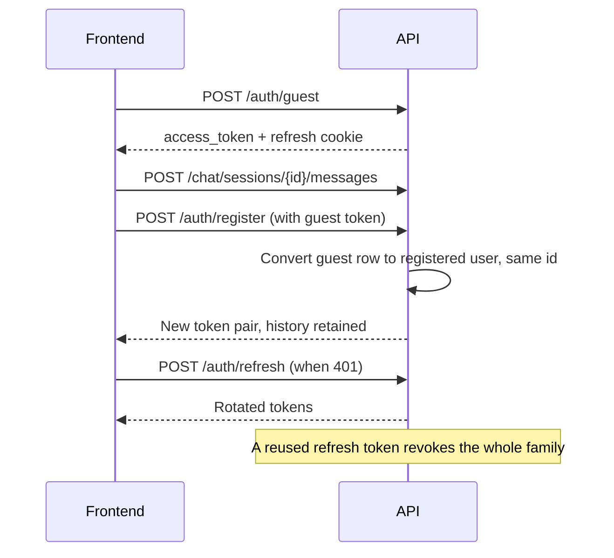
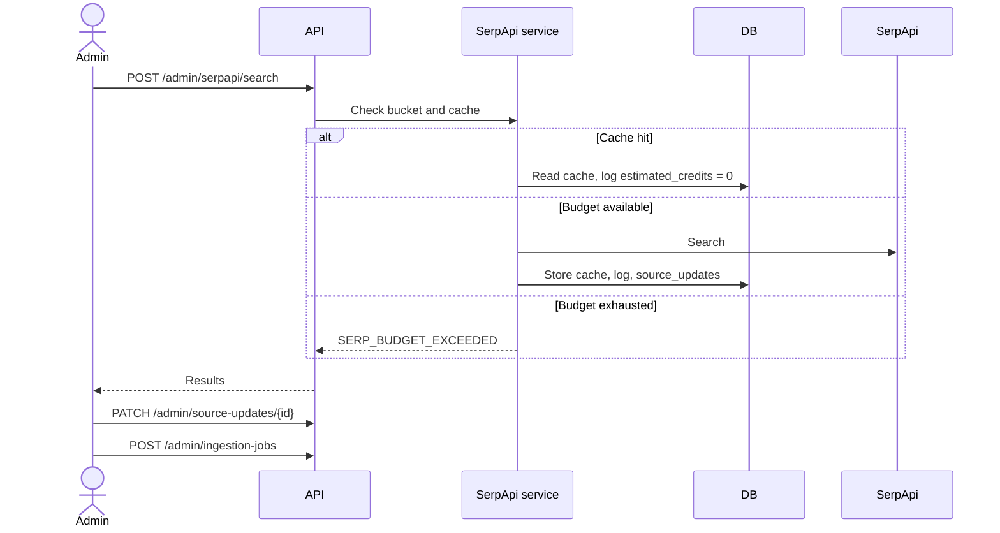
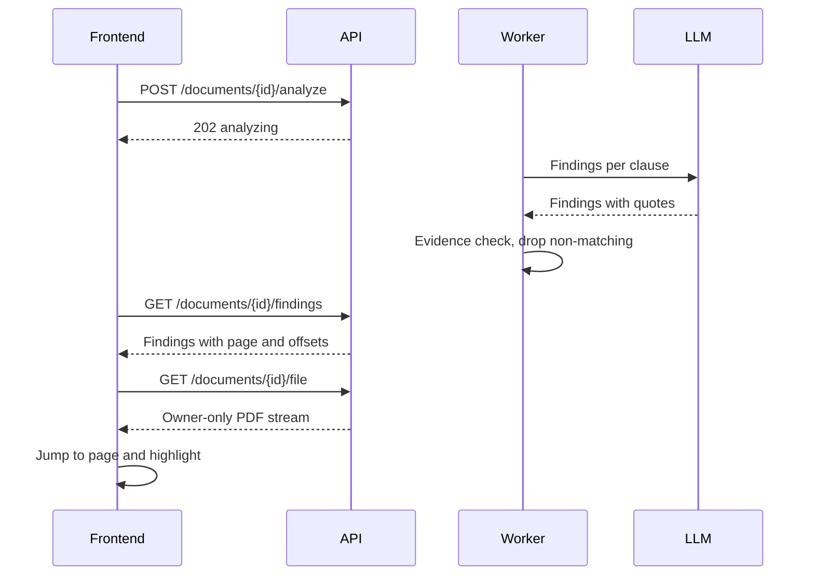
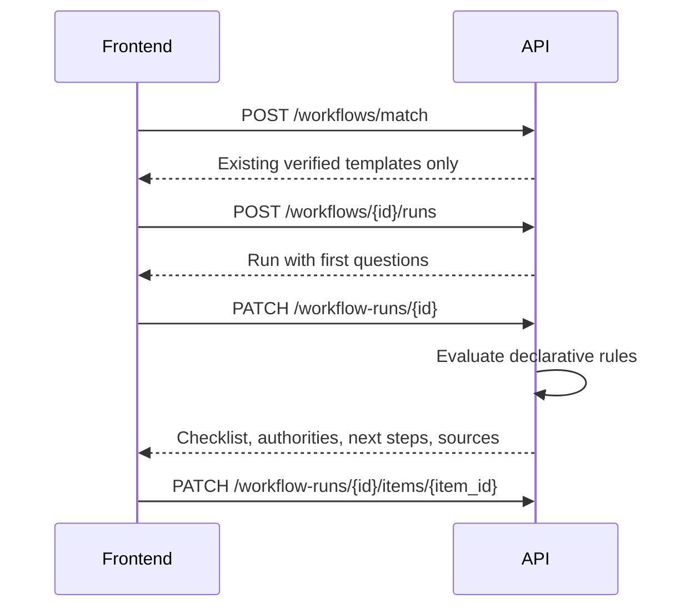

# 12 – API Specification

Base URL: `http://localhost:8000/api/v1`. Swagger: `http://localhost:8000/docs`. FastAPI generates OpenAPI from Pydantic schemas, and this document defines the contract those schemas must implement.

Examples use made-up IDs and illustrative content. They are not legal statements.

## 1. Conventions

| Topic | Rule |
|---|---|
| Auth | `Authorization: Bearer <access_token>`. Public endpoints are marked. |
| Refresh token | httpOnly, SameSite=Lax cookie scoped to `/api/v1/auth` |
| Content | JSON, except uploads (multipart) and streaming (SSE) |
| IDs | UUID |
| Dates | `YYYY-MM-DD`; timestamps in ISO 8601 UTC |
| Pagination | `?limit=20&cursor=...` (limit 1–100). Response: `{"items":[],"next_cursor":null}` |
| Isolation | Another user's record returns **404**, never 403, to avoid revealing it exists |
| Request ID | Response header `X-Request-ID` |

### Errors

```json
{"error":{"code":"VALIDATION_ERROR","message":"Question is too long.","details":[{"field":"content","issue":"max_length"}],"request_id":"req_01"}}
```

| HTTP | Code | When |
|---|---|---|
| 400 | `INVALID_FILE` | Not a valid PDF, encrypted |
| 401 | `UNAUTHENTICATED` | Missing or expired token |
| 403 | `FORBIDDEN` | Not admin, or guest using a registered-only feature |
| 404 | `NOT_FOUND` | Missing or not owned |
| 409 | `CONFLICT` | Email exists, document not ready |
| 413 | `FILE_TOO_LARGE` | Over limit |
| 422 | `VALIDATION_ERROR` | Schema failure |
| 429 | `RATE_LIMITED` | With `Retry-After` |
| 429 | `SERP_BUDGET_EXCEEDED` | Bucket exhausted |
| 500 | `INTERNAL_ERROR` | Unexpected |
| 503 | `LLM_UNAVAILABLE`, `FEATURE_UNAVAILABLE`, `DEPENDENCY_UNAVAILABLE` | Provider absent or down |

## 2. Endpoints added to the brief

`POST /chat/sessions/{id}/messages` remains the primary endpoint. The routes below support it. Workflow, matter and reminder routes are P1 and are built only if those features are; legal aid routes are also P1.

| Endpoint | Why |
|---|---|
| `POST /auth/guest` | Chat without sign-up while keeping user-level isolation |
| `DELETE /users/me`, `GET /users/me/export` | User-controlled deletion and data access |
| `GET /legal/search` | The Research page needs unified search; the brief covered only cases |
| `POST /feedback` | Feedback page; the brief's route only covers answers |
| `PATCH /admin/sources/{id}`, `POST /admin/ingestion-jobs` | Source Management cannot act without them |
| `POST /admin/serpapi/search`, `GET /admin/source-updates`, `PATCH /admin/source-updates/{id}` | Discovery workflow and human review |
| `GET /admin/feedback` | Review of feedback |
| `POST /documents/{id}/analyze`, `GET /documents/{id}/clauses`, `GET /documents/{id}/findings`, `GET /documents/{id}/file` | Clause explanations, findings and evidence display |
| `GET /legal/acts/{id}/amendments`, `GET /legal/sections/{id}/compare`, `GET /legal/sections/{id}/related`, `POST /legal/citations/verify`, `POST /legal/research/explain` | Advanced Research |
| `/workflows`, `/workflow-runs` routes | Guided Action Planner |
| `/matters`, `/matter-events`, `/matter-deadlines`, `/matter-notes`, `/reminders/due` routes | Case Companion |

## 3. Flows

### Auth and guest upgrade



### Discovery review



### Document evidence



### Action plan



The chat flow is in [08 §4](08-system-architecture.md#4-chat-request-lifecycle), document flow in [04 §4](../product/04-user-personas-and-journeys.md).

## 4. Auth and users

### POST /auth/guest (public)
Request: `{"preferred_language":"te"}`. `201`:
```json
{"access_token":"<jwt>","token_type":"bearer","expires_in":900,"user":{"id":"7f1c...","is_guest":true,"role":"user"}}
```

### POST /auth/register (public; guest token optional)
```json
{"email":"user@example.com","password":"<min 10 chars>","display_name":"Asha","privacy_notice_version":"v1"}
```
`201` same shape, `is_guest:false`. Errors: `409 CONFLICT`, `422`.

### POST /auth/login (public)
`{"email":"...","password":"..."}` → `200`; always a generic `401` on failure. Limit 5 per minute per IP and account.

### POST /auth/refresh (cookie) → `200` new tokens. POST /auth/logout → `204`, revokes family.

### GET /users/me
```json
{"id":"7f1c...","email":"user@example.com","display_name":"Asha","role":"user","is_guest":false,"preferences":{"preferred_language":"te","state_code":"TG","store_history":true,"document_retention_days":30,"voice_output_enabled":false}}
```

### PATCH /users/preferences
Any subset of `preferences`; validated against supported languages, State codes and 1–365 days. `200` returns the full object.

### GET /users/me/export → `200` JSON of profile, preferences, sessions, messages, feedback, document metadata. Original files are downloaded separately from a later version.

### DELETE /users/me
Body `{"password":"..."}` (guests omit it). `202 {"status":"scheduled"}`; login is disabled at once, purge job queued.

## 5. Chat

### POST /chat/sessions
`{"language":"te","state_code":"TG"}` → `201 {"id":"s1...","title":null,"language":"te","state_code":"TG","created_at":"2026-11-02T09:00:00Z"}`

### GET /chat/sessions → paginated summaries. 
### GET /chat/sessions/{id} → session with `messages` (paginated by `limit`, `cursor`).
### DELETE /chat/sessions/{id} → `204`.

### POST /chat/sessions/{id}/messages

Request:
```json
{"content":"నేను కొన్న ఫోన్ పాడైంది, దుకాణదారుడు రీఫండ్ ఇవ్వడం లేదు. నా హక్కులు ఏమిటి?","response_language":"te","state_code":null,"event_date":null,"document_id":null}
```
Validation: content 1–2,000 characters; language in supported set; `document_id` optional, must belong to the user and be `ready`, otherwise `404` or `409`. Guests get `403` with a document. The ID is recorded in `retrieval_trace`, and the frontend resends it for follow-ups. Limit 20 per minute and 200 per day for each user; guests 50 per day.

With `Accept: text/event-stream`, the response is SSE:

```text
event: message_created
data: {"user_message_id":"m1","assistant_message_id":"m2"}

event: status
data: {"stage":"retrieving","label_key":"status.searching"}

event: status
data: {"stage":"validating","label_key":"status.checking"}

event: delta
data: {"text":"..."}

event: citation
data: {"marker":"C1","source_type":"central_act","title":"Section ..., Consumer Protection Act, 2019","jurisdiction":"central","effective_status":"in_force","source_url":"https://...","last_verified_at":"2026-11-01T00:00:00Z","excerpt":"..."}

event: done
data: { /* complete AssistantMessage */ }
```

Stages: `understanding`, `retrieving`, `generating`, `validating`, `translating`. `delta` events are emitted **only after** validation. If the stream fails, `event: error` carries the error object. Without the SSE header, the response is `200` with the final object.

**AssistantMessage:**
```json
{
  "id":"m2","session_id":"s1","role":"assistant","language":"te",
  "answer_status":"answered","intent":"rights_information","urgency":"none",
  "law_as_of":"2026-11-02","translation_status":"ok",
  "content":"...[[C1]]...",
  "sections":{"short_answer":"...","law_explanation":"...","responsibilities":"...","next_steps":["..."],"uncertainty_notes":["..."]},
  "citations":[{"marker":"C1","chunk_id":"c9","section_id":"u1","case_id":null,"source_type":"central_act","title":"...","act_name":"Consumer Protection Act, 2019","section_number":"...","jurisdiction":"central","state_code":null,"effective_status":"in_force","source_url":"https://...","last_verified_at":"2026-11-01T00:00:00Z","excerpt":"..."}],
  "related_provisions":[{"section_id":"u2","title":"..."}],
  "clarifying_questions":[],
  "evidence":[],
  "suggested_actions":[{"type":"open_workflow","workflow_id":"w1","label_key":"action.plan"},{"type":"compare_provision","section_id":"u9","with_section_id":"u10"},{"type":"attach_document"},{"type":"open_legal_aid"}],
  "legal_aid_prompt":{"show":true,"reason":"affordability_mentioned"},
  "helplines":[],
  "disclaimer":"...","created_at":"2026-11-02T09:00:12Z"
}
```

`evidence` follows the `POST /documents/{id}/ask` shape when a document is attached. `suggested_actions` only offer features that are enabled and verified records that exist. They are generated by the server and never contain model-written URLs.

Status-specific:

| `answer_status` | Populated | Empty |
|---|---|---|
| `needs_clarification` | `clarifying_questions`, short content | `citations` |
| `insufficient_sources` | Explanation, search suggestions, possibly related sources | Legal claims |
| `refused` | Reason and alternatives | `citations` |
| `urgent_referral` | `helplines` first, safety text; may include answer sections | n/a |

### POST /chat/messages/{id}/feedback
`{"rating":"down","category":"wrong_citation","comment":"Section seems wrong"}` → `201`. A repeat updates the existing feedback.

## 6. Legal research (public)

### GET /legal/acts
Query: `q`, `source_type`, `jurisdiction_level`, `state_code`, `effective_status`, `year`, `limit`, `cursor`. Only `verified` records appear.
```json
{"items":[{"id":"a1","short_title":"Consumer Protection Act, 2019","act_number":"35 of 2019","source_type":"central_act","jurisdiction_level":"central","state_code":null,"enactment_date":"2019-08-09","commencement_date":null,"commencement_note":"Check notification","effective_status":"in_force","source_url":"https://...","last_verified_at":"2026-11-01T00:00:00Z"}],"next_cursor":null}
```

### GET /legal/acts/{id}
The above plus `full_title`, `amendment_history`, `repealed_by`, and a `chapters` tree with section IDs.

### GET /legal/sections/{id}
Query: `as_of` optional.
```json
{"id":"u1","act":{"id":"a1","short_title":"..."},"section_number":"35","heading":"...","chapter_title":"...","text_original":"...","language":"en","version_no":1,"valid_from":"2020-07-20","valid_to":null,"effective_status":"in_force","amendment_note":null,"versions":[{"id":"u1","version_no":1,"valid_from":"2020-07-20","valid_to":null}],"concordance":[],"source":{"title":"...","url":"https://...","publisher":"..."},"last_verified_at":"2026-11-01T00:00:00Z"}
```

### GET /legal/search
Query: `q` (required, 2–300 chars), `types=act,section,case`, filters above, `as_of`, `language`, `limit`.
```json
{"items":[{"type":"section","id":"u1","title":"...","snippet":"...","jurisdiction_level":"central","state_code":null,"source_url":"https://...","effective_status":"in_force","relevant_date":"2020-07-20","score":0.031}],"next_cursor":null,"exact_match":false}
```

### GET /legal/acts/{id}/amendments
```json
{"items":[{"id":"am1","section_id":"u1","amending_title":"...","effect":"substituted","effective_date":"2021-01-01","notification_ref":"...","source_url":"https://...","last_verified_at":"..."}],"coverage":"partial","next_cursor":null}
```

### GET /legal/sections/{id}/compare
Query: exactly one of `with_section_id`, `with_version`.
```json
{"left":{"id":"u9","title":"Section 420, Indian Penal Code, 1860","valid_from":"...","valid_to":"2024-06-30","effective_status":"repealed","source_url":"https://..."},"right":{"id":"u10","title":"...","valid_from":"2024-07-01","valid_to":null,"effective_status":"in_force","source_url":"https://..."},"relation":"partial","mapping_source":{"title":"...","url":"https://..."},"diff":[{"op":"equal","text":"..."},{"op":"delete","text":"..."},{"op":"insert","text":"..."}],"caution":"Wording differences do not establish legal effect."}
```
`404` if no verified mapping exists for an old-to-new pair.

### GET /legal/sections/{id}/related
```json
{"judgments":[{"case_id":"cs1","case_title":"...","court":"Supreme Court of India","decision_date":"2015-03-24","relation":"strikes_down","paragraph_ref":"...","source_url":"https://...","last_verified_at":"..."}],"provisions":[{"section_id":"u2","title":"...","relation":"same_chapter"}],"coverage_note":"Curated set. Later treatment is not tracked."}
```

### POST /legal/citations/verify
`{"citation":"Section 999, Bharatiya Nyaya Sanhita","as_of":null}`, limit 30 per minute.
```json
{"status":"not_found","parsed":{"act":"Bharatiya Nyaya Sanhita, 2023","section":"999"},"matches":[],"successor":null,"message":"Not found in the verified library.","checked_at":"2026-11-10T08:00:00Z"}
```
Status is a `citation_check`. This confirms a record exists, not that it supports an argument.

### POST /legal/research/explain
`{"section_ids":["u1"],"case_ids":[],"question":null,"response_language":"te"}`, up to 5 records. Returns `sections`, `citations`, `answer_status`, `disclaimer`, in the same shapes as AssistantMessage. `503 LLM_UNAVAILABLE` if no LLM.

### GET /legal/cases/search
Query: `q`, `court`, `from_date`, `to_date`, `limit`, `cursor`. Curated only; response includes `"coverage_note"`.

### GET /legal/cases/{id}
Title, citations, court, bench, date, `verified_summary` or null, source and passages.

### GET /legal/sources
`{"items":[{"id":"so1","title":"...","publisher":"...","source_type":"central_act","jurisdiction_level":"central","source_url":"https://...","last_verified_at":"...","version_label":"..."}],"next_cursor":null}`

## 7. Documents (registered users only; guests get 403)

### POST /documents/upload
Multipart: `file` (PDF, up to 20 MB, up to 100 pages), `consent=true` (required), `retention_days` (optional). `202`:
```json
{"id":"d1","status":"uploaded","original_filename":"rental.pdf","retention_until":"2026-12-02T09:00:00Z"}
```

### GET /documents → paginated. 
### GET /documents/{id}
```json
{"id":"d1","status":"ready","original_filename":"rental.pdf","page_count":6,"ocr_used":false,"sensitive_data_flags":["possible_aadhaar_number"],"summary_available":false,"retention_until":"2026-12-02T09:00:00Z","failure_reason":null}
```

### POST /documents/{id}/summarize
`{"response_language":"hi"}` → `200` `{"document_type_guess":"rental_agreement","plain_summary":"...","limits":["..."],"review_recommended":true}`, or `409 CONFLICT` if not ready. Cached per language, as `user_documents.summary_json` keyed by language code.

### POST /documents/{id}/ask
`{"question":"Can the landlord keep my deposit?","response_language":"en"}`
```json
{"answer":"...","evidence":[{"marker":"E1","page":2,"quote":"...","char_start":1820,"char_end":1902}],"legal_citations":[],"answer_status":"answered","disclaimer":"..."}
```

### POST /documents/{id}/analyze
`{"response_language":"en"}` → `202 {"job_id":"j2","status":"queued"}`. `409 CONFLICT` if the document is not ready. Idempotent per language.

### GET /documents/{id}/clauses
Query: `language`.
```json
{"items":[{"id":"cl1","clause_index":3,"clause_label":"3.","title":"Security deposit","original_text":"...","page_start":2,"page_end":2,"explanation":"...","finding_ids":["f1"]}],"next_cursor":null}
```

### GET /documents/{id}/findings
Query: `type` (a `finding_type`), `language`.
```json
{"items":[{"id":"f1","finding_type":"penalty","title":"Late payment fee","explanation":"...","party":"tenant","due_date":null,"due_text":null,"amount_text":"2% per month","confidence":"stated","from_ocr":false,"evidence":{"page":3,"quote":"...","char_start":4120,"char_end":4188},"clause_id":"cl4"}],"next_cursor":null,"dropped_unverified_count":2}
```
`dropped_unverified_count` is shown so quality is visible.

### GET /documents/{id}/file
Owner only. Streams `application/pdf`. Returns 404 for anyone else.

### DELETE /documents/{id} → `204`; file and chunks removed immediately, with the row kept minimally as `deleted` for job integrity and purged on the next retention run.

## 7a. Workflows

### GET /workflows (public)
Query: `topic`, `state_code`, `language`. Only `verified`. `{"items":[{"id":"w1","template_key":"consumer-defective-goods","version":2,"title":"...","topic":"consumer","jurisdiction_level":"central","reviewed_at":"...","last_verified_at":"..."}],"next_cursor":null}`

### POST /workflows/match (public, rate limited)
`{"situation":"My phone is defective and the shop refuses a refund","language":"en"}` → `{"matches":[{"workflow_id":"w1","title":"...","reason":"..."}],"safety":{"urgency":"none"},"none_suitable_note":"..."}`. Only existing verified templates can be returned. Text is redacted and not stored.

### GET /workflows/{id} (public)
Metadata, questions and sources.

### POST /workflows/{id}/runs (guest or user)
`{"language":"te","state_code":"TG","matter_id":null}` → `201` run.

### GET /workflow-runs → own plans.
### GET /workflow-runs/{id}
```json
{"id":"r1","workflow":{"id":"w1","version":2,"title":"...","reviewed_at":"..."},"status":"in_progress","answers":{"state":"TG"},"next_questions":[],"checklist":[{"id":"i1","item_key":"gather_invoice","item_type":"document","label":"...","why":"...","status":"pending","sources":[{"title":"...","url":"https://..."}]}],"authorities":[{"name":"...","type":"government_service","url":"https://...","last_verified_at":"..."}],"next_steps":["You may consider..."],"escalation":{"show":false,"message":null},"disclaimer":"..."}
```

### PATCH /workflow-runs/{id}
`{"answers":{"purchase_date":"2026-09-01"},"status":null,"matter_id":null}` → run, with the checklist recalculated. Existing item progress is retained.

### PATCH /workflow-runs/{id}/items/{item_id}
`{"status":"done"}` → item.

## 7b. Matters and reminders (registered users only)

| Endpoint | Request | Response |
|---|---|---|
| `POST /matters` | `{"title":"Deposit dispute","category":"tenancy","state_code":"UP"}` | `201` matter |
| `GET /matters` | `status`, `limit`, `cursor` | Paginated summaries with next deadline |
| `GET /matters/{id}` | | Matter with documents, plan and deadline counts |
| `PATCH /matters/{id}` | `{"title":"...","status":"closed"}` | Matter |
| `DELETE /matters/{id}` | Query `delete_documents=false` | `204`. Attached documents stay unless requested. |
| `POST /matters/{id}/documents` | `{"document_id":"d1"}` | `201`. Both must belong to the user. |
| `DELETE /matters/{id}/documents/{document_id}` | | `204`, detaches only |
| `GET /matters/{id}/timeline` | | `{"items":[{"date":"2026-10-01","kind":"event","title":"...","origin":"document","source_finding_id":"f1"},{"date":"2026-12-01","kind":"deadline","title":"...","status":"pending"}]}` |
| `POST /matters/{id}/events` | `{"event_date":"2026-10-01","title":"...","description":null,"source_finding_id":null}` | `201` event |
| `DELETE /matter-events/{id}` | | `204` |
| `GET /matters/{id}/deadlines` | `status` | List |
| `POST /matters/{id}/deadlines` | `{"title":"...","due_date":"2026-12-01","confirm":true,"remind_at":"2026-11-24T04:00:00Z","source_finding_id":"f1"}` | `201`. `422` unless `confirm` is true. |
| `PATCH /matter-deadlines/{id}` | `{"status":"done","reminder_seen":true}` | Deadline |
| `GET /matters/{id}/deadlines.ics` | | `text/calendar`, pending deadlines with neutral titles |
| `GET /matters/{id}/notes` | | Paginated notes |
| `POST /matters/{id}/notes` | `{"content":"..."}` up to 10,000 characters | `201` |
| `DELETE /matter-notes/{id}` | | `204`, hard delete |
| `GET /reminders/due` | | `{"items":[{"deadline_id":"dl1","matter_id":"mt1","title":"...","due_date":"2026-12-01","notice":"Based on a date you confirmed. Check actual deadlines with the court, authority or your advocate."}]}` |

## 8. Language and voice

### GET /languages (public)
`{"items":[{"code":"te","name":"Telugu","native_name":"తెలుగు","status":"planned","voice_input":"browser","voice_output":"browser"}]}`

`status` is `supported`, `beta` or `planned`. At first only `en` is `supported`. Hindi and Telugu examples in this document apply once enabled; until then, an unenabled `response_language` returns `422 VALIDATION_ERROR`.

### POST /languages/detect
`{"text":"naaku refund ivvaledu"}` → `{"language":"te","script":"latin","is_romanized":true,"confidence":0.74}`

### POST /languages/translate
`{"text":"...","source":"en","target":"hi","protected_terms":["Section 35"]}` → `{"text":"...","provider":"llm","protected_terms_ok":true}`. Limit 5,000 characters.

### POST /voice/transcribe, POST /voice/synthesize
Reserved for server speech. Until a provider is configured: `503 FEATURE_UNAVAILABLE`. Contract: multipart `audio`, `language` → `{"text":"..."}`; `{"text":"...","language":"te"}` → `audio/*`.

## 9. Legal aid (public; only `verified` records)

### GET /legal-aid/eligibility
Query: `state_code`, `language`. Returns `{"categories":[{"code":"...","description":"...","source_section_id":"..."}],"merit_note":"...","income_rule":{"state_code":"TG","value":null,"note":"Check with authority","source_url":"..."},"decision_note":"The authority decides eligibility."}`

### GET /legal-aid/authorities
Query: `state_code` (optional), `district`, `type`.
`{"items":[{"id":"la1","authority_type":"SLSA","name":"...","state_code":"TG","district":null,"phone":"...","email":"...","website_url":"https://...","source_url":"https://...","last_verified_at":"..."}],"next_cursor":null}`

### GET /legal-aid/resources
Query: `state_code`, `resource_type`, `language`. `resource_type=government_service` lists labelled official services such as Tele-Law, each with its verified URL. These are links and not integrations.

### GET /legal-aid/helplines
Query: `state_code`, `safety_topic`. Same shape, filtered to `resource_type=helpline`.

## 10. Feedback and system

### POST /feedback
`{"category":"translation","comment":"..."}` → `201`.

### GET /health (public)
```json
{"status":"ok","version":"0.1.0","checks":{"database":"ok","embedding_model":"loaded","llm":"configured","translation":"llm","storage":"ok"}}
```
Never exposes secrets. `status` can be `degraded`. Does not call paid APIs.

## 11. Admin (role `admin`; all actions audited)

| Endpoint | Purpose | Example response or body |
|---|---|---|
| `GET /admin/source-status` | Corpus health | `{"counts":{"verified":24,"needs_review":3},"stale":[{"id":"so1","title":"...","last_verified_at":"..."}]}` |
| `PATCH /admin/sources/{id}` | Change validation status | `{"validation_status":"verified","note":"Checked against official copy"}` |
| `GET /admin/ingestion-status` | Jobs | `{"items":[{"id":"j1","job_type":"legal_parse","status":"running","progress":{"parsed":120,"expected":358}}],"next_cursor":null}` |
| `POST /admin/ingestion-jobs` | Start job | `{"job_type":"legal_parse","source_id":"so1"}` → `202` |
| `GET /admin/serpapi-usage` | Credits | See below |
| `POST /admin/serpapi/search` | Discovery | `{"bucket":"legal_discovery","engine":"google","template":"official_act_lookup","params":{"act":"Consumer Protection Act"},"confirm_reserve":false,"force_refresh":false,"reason":null}` |
| `GET /admin/source-updates` | Review queue | Filter `status` |
| `PATCH /admin/source-updates/{id}` | Review | `{"status":"approved"}` |
| `GET /admin/feedback` | Feedback queue | Filter `category`, `review_status` |

```json
{
  "total_budget":2250,
  "estimated_used":412,
  "buckets":[{"bucket":"legal_discovery","budget":600,"estimated_used":180,"remaining":420}],
  "actual":{"searches_left":1830,"this_month_usage":420,"checked_at":"2026-11-10T08:00:00Z"},
  "difference":8
}
```

## 12. Rate limits

| Scope | Limit |
|---|---|
| Chat messages | 20 per minute per user; 200 a day for users; 50 a day for guests |
| Guest creation | 10 per hour per IP |
| Login | 5 per minute per IP and account |
| Upload | 10 per day per user |
| Public research | 60 per minute per IP |
| Translate | 30 per minute per user |
| Citation verification | 30 per minute per IP |
| Workflow matching, research explanation | 10 per minute per user or IP |
| Document analysis | 20 per day per user |

In-process counters are acceptable locally; a shared store is needed once more than one process runs ([25](../infrastructure/25-saas-scalability.md)).

## 13. CORS

Allow only `CORS_ORIGINS`, by default `http://localhost:5173`, with credentials enabled.
