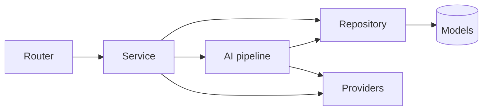

# 14 – Backend Architecture

## 1. Stack

Python 3.12, FastAPI, SQLAlchemy 2 async, Alembic, Pydantic v2. Runs natively at `127.0.0.1:8000` against a single SQLite file (no server, no Docker). API contract: [12](12-api-specification.md). Schema: [11](11-database-schema.md).

## 2. Repository structure and changes from the brief

```text
vidhiverse-ai/
├── frontend/
├── backend/
│   ├── app/
│   │   ├── api/v1/          # routers
│   │   ├── core/            # settings, security, container, logging, errors, languages
│   │   ├── models/          # SQLAlchemy
│   │   ├── schemas/         # Pydantic
│   │   ├── repositories/    # queries, always scoped by user where applicable
│   │   ├── services/        # documents, research, workflows, matters, chat, legal_aid, language, serpapi, admin, storage
│   │   ├── ai/              # replaces top-level ai-engine/
│   │   │   ├── rag/  embeddings/  retrieval/  prompts/  evaluation/  llm/  safety/  documents/  citations/
│   │   ├── ingestion/       # parsers, chunkers, cli
│   │   └── workers/         # job poller
│   ├── tests/
│   └── requirements.txt
├── database/{migrations,seeds,schema}/   # schema/schema.sql + apply_schema.py create storage/vidhiverse.db
├── legal-data/{central,state,judgments,metadata}/
├── scripts/  storage/  docs/  tests/
├── .gitignore  README.md
```

| Change | Reason |
|---|---|
| `ai-engine/` → `backend/app/ai/` | It runs in the backend process and shares its models, settings and dependencies. A separate top-level package would add install and import complexity with no separate deployment benefit. The module boundary is preserved, and an import rule keeps `ai/` free of `api/`. |
| Added `repositories/` | Central place to enforce user isolation |
| Added `ai/safety/`, `ai/llm/` | Clear ownership of layers and providers |
| No root `docker-compose.yml` / `.env.example` | The database is a SQLite file, not a container ([19](../infrastructure/19-docker-configuration.md)); `backend/.env.example` and `frontend/.env.example` are each tool's own config |
| `tests/` at root | Cross-stack end-to-end and evaluation data; unit tests stay in `backend/tests` |

## 3. Layers



Routers hold no logic. Services own transactions. A database session is never held open during an LLM call: long LLM waits would otherwise exhaust the connection pool.

## 4. Provider interfaces

```python
class EmbeddingProvider(Protocol):
    async def embed_queries(self, texts: list[str]) -> list[list[float]]: ...
    async def embed_passages(self, texts: list[str]) -> list[list[float]]: ...

class TranslationProvider(Protocol):
    async def translate(self, text: str, source: str, target: str,
                        protected: list[str]) -> TranslationResult: ...

class SpeechProvider(Protocol):
    async def transcribe(self, audio: bytes, language: str) -> str: ...
    async def synthesize(self, text: str, language: str) -> bytes: ...

class StorageProvider(Protocol):
    async def put(self, key: str, stream: BinaryIO) -> None: ...
    async def open(self, key: str) -> BinaryIO: ...
    async def delete(self, key: str) -> None: ...
```

`LLMProvider` is in [09 §6](09-rag-architecture.md). Selection by settings occurs in `core/container.py`. `LocalStorageProvider` rejects path traversal and keys are generated by the server, never from filenames.

## 5. Chat orchestrator

```python
async def handle_message(session, user, payload) -> AsyncIterator[ChatEvent]:
    saved = await messages.save_user(...)
    yield MessageCreated(...)
    safety = input_safety.check(payload)          # Layer 1, no LLM needed for urgent words
    if safety.urgency == "immediate_safety":
        helplines = await legal_aid.helplines(...)
    ctx = await understanding.run(...)
    if ctx.missing_required:
        yield await finish(needs_clarification(ctx))
        return
    yield Status("retrieving")
    evidence = await retriever.search(ctx)         # Layer 2
    if not evidence.sufficient:
        yield await finish(insufficient_sources(ctx, evidence))
        return
    yield Status("generating")
    draft = await generator.run(ctx, evidence)     # Layer 3
    yield Status("validating")
    draft = await validator.validate_or_repair(draft, evidence)   # Layer 4
    draft = output_safety.apply(draft)
    final = await localizer.to_language(draft, ctx.language)      # protected tokens
    async for event in reveal(final):
        yield event
    await persist(final)
```

This outline conveys order; it is not final source code.

## 5a. Supporting service modules

`services/chat` stays the orchestrator: it routes by intent and builds `suggested_actions`. The modules below support it, and P1 modules are enabled by settings.

| Module | Responsibility |
|---|---|
| `ai/documents/` | Clause segmentation, finding extraction, `evidence.py` quote checks |
| `ai/citations/` | Validator and citation parser, shared by chat, explanations and `POST /legal/citations/verify` |
| `services/research/` | Search, comparison with `difflib`, related authorities, amendments |
| `services/workflows/` | Template loading, rule evaluation with a safe declarative evaluator (no `eval`), runs, matching |
| `services/matters/` | Matters, timeline aggregation, deadlines, reminders, `.ics` with `icalendar` |

`GET /documents/{id}/file` streams from `StorageProvider` after an ownership check, with `Content-Disposition: inline`, `Cache-Control: private, no-store`, and no signed public link.

## 6. Worker

A task started in FastAPI's lifespan polls every 3 seconds:

```sql
UPDATE ingestion_jobs SET status='running', started_at=now(), attempts=attempts+1
WHERE id = (SELECT id FROM ingestion_jobs WHERE status='queued'
            ORDER BY created_at FOR UPDATE SKIP LOCKED LIMIT 1)
RETURNING *;
```

CPU-heavy steps (OCR, parsing, embedding) use a `ProcessPoolExecutor` so they do not block the event loop. Maximum 3 attempts. On startup, rows stuck at `running` return to `queued`. `retention_purge` runs hourly. `SKIP LOCKED` makes a future separate worker process possible with no redesign.

## 7. Authentication

| Item | Implementation |
|---|---|
| Passwords | Argon2id |
| Access | JWT, 15 minutes, claims `sub`, `role`, `guest`, `exp`, `jti`, signed with `SECRET_KEY` |
| Refresh | Random 256-bit, hash stored, rotates each use, 30 days, reuse revokes the family |
| Guests | Refresh 30 days; expired guests are purged by job |
| Admin | `require_admin` dependency; no public promotion route |
| Dependencies | `get_current_user`, `require_registered`, `require_admin` |

## 8. Cross-cutting

| Concern | Approach |
|---|---|
| Logging | JSON logs with `request_id`, route, status, duration. Bodies are never logged. |
| Errors | Central handlers produce the standard error shape |
| Rate limiting | Middleware with in-process counters and limits in [12 §12](12-api-specification.md#12-rate-limits) |
| Upload security | Size limit while streaming, `%PDF` signature, PyMuPDF parsing in a worker process with a timeout, no scripts or embedded file execution |
| Timeouts | LLM 60 s, translation 30 s, SerpApi 20 s; each maps to a defined error |
| Config | `pydantic-settings`; refuses start on missing secrets in non-development mode |

## 9. Python dependencies (pin in lockfile)

`fastapi`, `uvicorn`, `sqlalchemy[asyncio]`, `aiosqlite`, `alembic`, `sqlite-vec`, `pydantic-settings`, `argon2-cffi`, `pyjwt`, `httpx`, `python-multipart`, `sentence-transformers`, `torch` (CPU), `pymupdf`, `pytesseract`, `dateparser`, `pyyaml`, `icalendar`, `pytest`, `pytest-asyncio`, `ruff`, `mypy`.

## 10. Observability (local)

`GET /health`, structured logs, and token, latency and retrieval data on each assistant message. No external monitoring in Phase 1.
