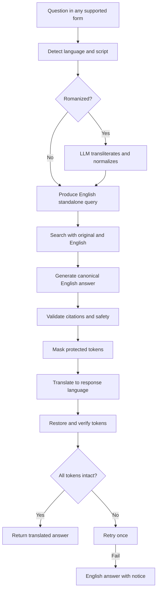

# 15 – Multilingual Architecture

## 1. Language plan

**Priorities (provisional, [D-25](../review/decision-register.md)):**

- **English:** the complete P0 chatbot experience.
- **Hindi and Telugu:** P1, subject to time, API availability and language-quality validation. Not part of the committed MVP scope.
- **Additional Indian languages:** P2.

**Multilingual-ready from the beginning.** These are built into P0 foundation work, so adding a language later needs no major structural change:

| Built now | Why |
|---|---|
| All UI text in i18n files; `lang` attributes; Unicode-safe storage | No hard-coded English |
| `language` fields already in the schema and API | No migration to add a language |
| `ENABLED_LANGUAGES` setting (`en` at first) and `GET /languages` | Enable by configuration |
| `TranslationProvider` interface; the localization step passes English through | Adding translation doesn't alter the pipeline |
| Multilingual embedding model; prompts and glossary organised per language | No re-embedding of the corpus |

**Not built until F-LANG starts:** glossary content, translated strings, Indic fonts, Romanized handling, language evaluation.

**Language not yet enabled:** the chatbot says in English that the language isn't available yet, offers to continue in English, and still shows verified helplines. It does not attempt an unvalidated translation.

**A language ships only after:** native-speaker review, protected-token tests, and per-language evaluation pass. Otherwise it stays disabled.

| Stage | Languages |
|---|---|
| P0 | English `en` |
| P1 (F-LANG) | Hindi `hi` and Telugu `te` |
| Next | Tamil, Kannada, Malayalam, Marathi, Bengali, Gujarati, Punjabi, Odia, Assamese, Urdu |
| P2 (F-LANG-X) | Remaining scheduled languages |

Urdu adds right-to-left layout, so it needs frontend work, and should be scheduled accordingly.

## 2. Pipeline



**Why English first:** official sources are mainly English, one validator can check all answers, and the masked translation step protects legal references. This is a hypothesis: compare it to direct generation in the LLM evaluation for Telugu quality ([09 §9](09-rag-architecture.md)).

## 3. Detection

| Case | Method |
|---|---|
| Telugu script | Unicode block |
| Devanagari | Unicode block; assumed Hindi at MVP (Marathi can look alike, so ask when unclear) |
| Latin script | Small library plus lexicon for Romanized Hindi and Telugu; LLM fallback |
| Code-mixed ("mera landlord deposit nahi de raha") | Treat as Romanized Hindi |

The user's selected language always determines the answer language. Detection only suggests a switch.

**Romanized input [ASSUMPTION]:** spelling varies widely, and quality is uncertain. Test with at least 20 real samples per language.

## 4. Protected-token translation

Before translation:

```text
A consumer may file a complaint under [[C1]] of the ⟦T1⟧. See ⟦T2⟧.
⟦T1⟧ = Consumer Protection Act, 2019      ⟦T2⟧ = Section 35
```

| Protected | Handling |
|---|---|
| Citation markers | Never altered; must appear exactly once for each occurrence |
| Act names | Kept in English; may be followed by a verified Hindi or Telugu name from the glossary |
| Section and Article numbers | Kept in Western digits; "Section" may be localized as "సెక్షన్" or "धारा" through the glossary |
| Case names, dates, amounts, phone numbers, URLs | Kept or formatted deterministically |

After translation, verify the token count and that numbers match. This check is deterministic and covered by tests.

## 5. Legal glossary

`backend/app/ai/prompts/glossary/{hi,te}.yaml` holds preferred terms, reviewed by a native speaker with legal knowledge:

```yaml
- en: bail
  hi: जमानत
  te: బెయిల్
  note: Explain on first use
- en: complaint (consumer)
  hi: उपभोक्ता शिकायत
  te: వినియోగదారు ఫిర్యాదు
```

Examples above are illustrative and require review. Seed about 150 terms before Week 3. Translated output is a helpful explanation, never authoritative law; **citation cards always display the original text**, with a label saying that the official text prevails. Official Hindi texts of statutes can be ingested later as `language='hi'` versions.

## 6. Translation providers

| Provider | Status | Note |
|---|---|---|
| `llm` | Default **[PROPOSED]** | Uses the configured LLM; check quality and data terms |
| `bhashini` | Pending access (L6) | Implement only after official documentation and terms are in hand ([D-06](../review/decision-register.md)) |
| `none` | Fallback | English with notice |

No BHASHINI endpoint, schema or quota is specified here because none has been confirmed from an official source. The configuration placeholders `BHASHINI_API_KEY` and `BHASHINI_USER_ID` come from the brief. Community clients suggest they are the right credentials, but that is unconfirmed.

**Exploration task (only with F-LANG, time-boxed to 1 day):** register if eligible, read official documentation, record terms, test 20 sentence pairs against the LLM, and decide.

## 7. Voice (F-VOICE)

**P2: future roadmap, not in the hackathon MVP.** The notes below are kept for that phase.

| Capability | MVP | Note |
|---|---|---|
| Input | Web Speech API `SpeechRecognition` | Support varies by browser; audio may go to the browser vendor's service, which we disclose first |
| Output | `speechSynthesis` | Depends on voices installed on the device |
| Server endpoints | `503 FEATURE_UNAVAILABLE` | Reserved for BHASHINI or another provider |

**Device matrix for the spike (L12):**

| Browser and OS | `en-IN` in | `hi-IN` in | `te-IN` in | `en` out | `hi` out | `te` out |
|---|---|---|---|---|---|---|
| Chrome on Android | test | test | test | test | test | test |
| Chrome on Windows | test | test | test | test | test | test |
| Edge on Windows | test | test | test | test | test | test |
| Safari on iOS | test | test | test | test | test | test |
| Firefox | test | test | test | test | test | test |

The voice button appears only if the current browser has the capability. Text flows must remain fully functional without voice. Do not read aloud in sensitive situations automatically. Strip citation markers before speaking.

## 8. Embeddings across languages

`multilingual-e5-small` is expected to place Hindi and Telugu questions near related English text, though quality for legal vocabulary is unknown. Measure recall@5 for each language separately using the same questions. If Telugu recall lags behind, retrieve by English query only and evaluate larger models. Do not lower the 90% target; report it.

## 9. Quality checks

| Check | Method |
|---|---|
| Legal meaning | Native speaker compares English and translated answers, scoring 1–5 |
| Terminology | Glossary adherence |
| Token integrity | Automatic |
| Reading level | Human rating |
| Numbers and negation | Reviewed specifically: dropped "not" is the most dangerous translation error |

Target: comprehension 90%+ (NFR-Q5), a target rather than a result.

## 9a. Language in each feature

| Feature | Approach |
|---|---|
| F-DOC | Original text stays as written; clause and finding explanations use the protected-token path; evidence quotes are never translated |
| F-RES | Legal text stays original; only explanations are translated |
| F-PLAN | Reviewed strings for each language, not machine translation at run time. Untranslated templates are unavailable in that language. |
| F-CASE | User content stays as entered |

## 10. Adding a language

1. Add configuration to `languages.py` and an i18n file.
2. Add fonts.
3. Create a reviewed glossary.
4. Add the evaluation question set.
5. Run the evaluation, set status `beta`, then `supported` after review.
