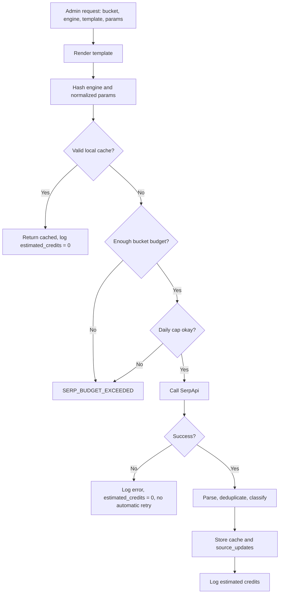

# 16 – SerpApi Integration

## 1. Principle

**SerpApi finds leads. It never supplies law.** A result is a candidate to be checked by a person. Chat never depends on it, and `SERPAPI_CHAT_FALLBACK_ENABLED=false` by default.

SerpApi also helps F-RES data work by finding official copies of judgments and notifications, and F-AID by finding official service pages. It never provides authority, and citation verification in `POST /legal/citations/verify` makes no SerpApi calls.

## 2. Budget

| `serp_bucket` | Purpose | Credits |
|---|---|---:|
| `legal_discovery` | Legal research and source discovery | 600 |
| `case_discovery` | Case-law discovery | 450 |
| `updates` | Legal updates and notifications | 350 |
| `regional_resources` | Regional legal resource discovery | 300 |
| `evaluation` | Testing and retrieval evaluation | 300 |
| `reserve` | Final demo and emergency reserve | 250 |
| **Total** | | **2,250** |

## 3. Credit facts to rely on

| Fact | Status |
|---|---|
| Only successful searches count; cached, errored, failed do not | **[VERIFIED: L3]** |
| A search counts as one regardless of the number of results | **[VERIFIED: L3]**, check for each engine |
| SerpApi's cache window | Not confirmed; our local cache does not depend on it |
| Whether the 2,250 credits expire or are monthly | **Unknown.** Check the account first ([D-05](../review/decision-register.md)). |
| Each engine costs one credit | **[ASSUMPTION]** Confirm for `google`, `google_scholar`, `google_news` with a test query and the account figure |

`SERPAPI_COST_PER_SEARCH` defaults to 1 and can be set by engine in `serpapi_config.yaml`.

## 4. Service design

Module: `backend/app/services/serpapi/` with `client.py`, `templates.py`, `parser.py`, `classifier.py`, `budget.py`, `cache.py`.

Budget check and log insert occur in one transaction with a row lock so parallel requests cannot overspend. `SERPAPI_DAILY_CAP` defaults to 50. Using `reserve` needs `confirm_reserve=true`.

## 5. Query templates

| Template | Engine | Bucket | Example |
|---|---|---|---|
| `official_act_lookup` | `google` | `legal_discovery` | `"{act}" site:indiacode.nic.in` |
| `gazette_notification` | `google` | `updates` | `"{act}" commencement notification site:egazette.gov.in` |
| `government_general` | `google` | `legal_discovery` | `{topic} (site:gov.in OR site:nic.in)` |
| `legal_aid_regional` | `google` | `regional_resources` | `{state} legal services authority site:nalsa.gov.in` |
| `case_scholar` | `google_scholar` | `case_discovery` | `"{case_name}" Supreme Court of India` |
| `case_official` | `google` | `case_discovery` | `"{case_name}" site:sci.gov.in` |
| `recent_news` | `google_news` | `updates` | `"{act}" amendment notified` |

Templates are the only query path. No free text from chat is sent, and no personal data.

## 6. Source classification

| Class | Rule | Treatment |
|---|---|---|
| `official_primary` | `indiacode.nic.in`, `egazette.gov.in`, `sci.gov.in`, `scr.sci.gov.in`, `ecourts.gov.in` | Review, then may be ingested |
| `official_secondary` | `nalsa.gov.in`, `doj.gov.in`, other `*.gov.in`, `*.nic.in` | Review |
| `court_or_scholar` | Google Scholar result | Lead only: find the official copy |
| `news` | Google News | Alert only |
| `other` | Everything else | Stored with low visibility, cannot be ingested |

Domain matching uses the parsed host and registered suffix, so `gov.in.evil.com` fails. URLs are normalized and deduplicated by `source_updates.discovered_url`.

## 7. Caching

| Bucket | Local TTL |
|---|---|
| `legal_discovery`, `case_discovery`, `regional_resources` | 30 days |
| `updates` | 7 days |
| `evaluation` | 90 days, for repeatability |

`force_refresh` needs a reason recorded in `audit_logs`.

## 8. Tracking estimated and actual

| Record | Meaning |
|---|---|
| `event_type='search'` | Our **estimated** credits per call |
| `event_type='account_snapshot'` | **Actual** values from SerpApi's account endpoint, fetched on admin dashboard load and at most every 15 minutes |

`GET /admin/serpapi-usage` displays both and the difference. Alert if the difference exceeds 5% or a bucket reaches 80%. Confirm whether the account endpoint is free of charge before scheduling it; it is believed to be, from memory.

## 9. Usage plan

| Week | Activity | Approx. credits |
|---|---|---:|
| Before 1 | One test per engine, to check cost and parser | 3 (from `evaluation`) |
| 1 | None: the service is built in Week 2, and Tier 1 URLs are found by hand | 0 |
| 2 | Official URLs still missing; curated case discovery | 110 |
| 3 | SLSA pages for demo States; updates sweep | 100 |
| 4 | Final update checks, evaluation only if needed | 40 |
| **Likely MVP total** | | **~250** |

**Remaining credits stay unspent** for corpus expansion. The allocation table is a ceiling, not a target.

## 10. Failure handling

`429`, timeout or `5xx`: log, no automatic retry, surface to admin. Malformed results: cache only if parse succeeds. Key absent: `SERPAPI_ENABLED=false`, all routes return `503 FEATURE_UNAVAILABLE`, and the rest of the product is unaffected.

## 11. Terms

Automated collection of search results raises separate terms questions for the underlying sites. The review ([D-08](../review/decision-register.md)) includes SerpApi's and each source's terms, and final ingestion uses official documents obtained directly.
