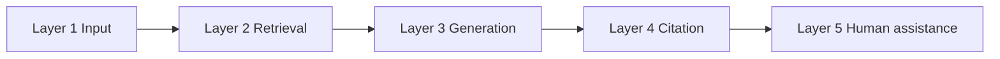

# 17 – AI Safety, Privacy and Security

These are design controls. **Nothing here is a claim of legal compliance.** Compliance needs a qualified assessment before launch ([D-04](../review/decision-register.md)).

## 1. Five safety layers

### Layer 1 – Input safety

| Check | Implementation |
|---|---|
| Validation | Length, encoding, control characters |
| Intent | `intent` enum, from the understanding step |
| Urgency | Keyword lists for each enabled language **first** (one is required before that language ships), then LLM classification. Never depends only on LLM. |
| Jurisdiction | Rule-based then LLM; ask if needed |
| Sensitive information | Patterns for Aadhaar-like, PAN-like, phone, email, bank numbers. Redact before external calls; store the redacted form by default. Warn the user. |
| Prompt injection | Delimit user data, ignore instructions by policy, do not rely on pattern filtering alone |

**Urgency:**

| Level | Triggers (examples) | Behaviour |
|---|---|---|
| `immediate_safety` | Violence now, suicide or self-harm, child in danger, trafficking, threats, illegal detention now | `urgent_referral`, helplines first, then calm information |
| `elevated` | Court date tomorrow, arrest of a relative, eviction today, deadline | Time-critical note, advocate and legal aid prompt |
| `none` | General questions | Standard |

Helpline candidates to verify before seeding: NALSA 15100 (L8), and from memory, emergency 112, women 181, child 1098, cybercrime 1930, Tele-Law (L10). **None goes live without an official source.** Self-harm helplines need specialist guidance on which to list.

### Layer 2 – Retrieval safety

Only `verified` sources; official-source priority; date and jurisdiction filters in SQL; historical law labelled; `unknown` status warned. Stale sources (not verified in 180 days) are flagged.

### Layer 3 – Generation safety

| Prohibited | Control |
|---|---|
| Fabricated provisions or judgments | Prompt rules, plus Layer 4 |
| Unsupported conclusions | Prompt, evidence gate, human evaluation |
| Guaranteed outcomes | Output patterns: "you will win", "guaranteed", "definitely illegal", in each enabled language |
| Instructions to evade law, destroy evidence or intimidate witnesses | `refused`, with lawful options explained |
| Discrimination, or personal opinions | Prompt; red-team testing |

A person asking how the law applies to them after committing an act is still entitled to rights information, such as bail, legal representation. Only help with evasion is refused.

### Layer 4 – Citation validation

Defined in [09 §7](09-rag-architecture.md). If it cannot be verified, it is not presented as fact.

### Layer 5 – Human assistance

Legal aid prompt when affordability, criminal charges, family violence or court deadlines appear; recommend an advocate for case-specific matters; urgent guidance; the disclaimer on each answer.

## 2. Prompt-injection design

Threats: user questions, uploaded documents, ingested text. Controls:

- Document and source text in delimited data blocks and treated as untrusted.
- The model has **no tools**. It cannot call APIs, run SerpApi, access other users' data or follow URLs. This limits damage from any injection.
- Retrieval is scoped by server-side user ID and is never controlled by the prompt.
- Validators run after the model, so injected "cite this fake section" instructions fail.
- System prompt disclosure is low-risk since it holds no secrets.

## 3. External LLM data rule

| Provider data terms | Public corpus | Redacted questions | Uploaded documents |
|---|---|---|---|
| May use content for training (L9) | Allowed | Demo and test only; disclosed | **Blocked** |
| Contractually no training | Allowed | Allowed with notice | Only with `LLM_ALLOW_USER_DOCUMENTS=true` and consent |
| Local (Ollama) | Allowed | Allowed | Allowed |

`LLM_DATA_POLICY` (`may_train`, `no_train`, `local`) is set explicitly by the operator after reading terms, and enforced in code.

**Consequence:** if only a free training-tier provider is available, Demo 2 must use a local model or a paid no-train provider with a synthetic document ([D-01](../review/decision-register.md)).

## 4. Privacy controls

| Principle | Control |
|---|---|
| Minimal data | Guests have no identifiers; no IP stored in the database; rate-limit counters kept in memory |
| Transparency | Privacy Centre lists data and providers |
| Choice | `store_history`, retention, deletion, export |
| User-level access | Isolation in repositories, 404 for others' records, automated tests |
| Logs | No question or document content; `request_id`; restricted admin views. Admins don't browse conversations in the MVP; negative feedback shows content only when the user attached it. |
| Purpose | No advertising, no model training on user data |

### Retention

| Data | Default | Purge |
|---|---|---|
| Guest account and chats | 30 days after creation | Worker |
| Registered chats | Until deleted, or 24 hours after last activity if `store_history=false` | Worker |
| Deleted sessions | Hidden at once, hard-deleted within 24 hours | Worker |
| Documents | 30 days, user adjustable 1–365 | Worker |
| Deleted account | Disabled at once, data purged within 24 hours | Worker |
| Matters, events, deadlines, notes | Until deleted; deleted within 24 hours of request | Worker |
| Workflow runs | Guest: with the guest account. Registered: until deleted. | Worker |
| Application logs | 14 days locally | Rotation |
| Audit logs | 1 year; actor reference nulled on account deletion | Manual review |

These periods are proposals for legal review ([D-10](../review/decision-register.md)).

## 4a. Feature-specific safeguards

| Feature | Risk | Safeguard |
|---|---|---|
| F-DOC | Invented or misread content | Exact-quote evidence check, dropped findings shown as a count, OCR warning, no unsupported "illegal" or "unenforceable" label |
| F-DOC | Injection through a document | Delimited data, no tools, evidence check applies after the model |
| F-RES | False confidence in `verified` or links | States that it confirms existence, not support; later treatment isn't tracked; comparison caution |
| F-PLAN | Wrong procedure, or implied representation | Human-authored and reviewed, versioned, review date, 180-day flag, options language, advocate and legal aid escalation, safety overrides workflows |
| F-PLAN | Limitation periods and fees | Shown only with verified source and a warning |
| F-CASE | Wrong or missed deadline | Stated dates only, user confirmation, no guarantee notice |
| F-CASE | Sensitive history | Registered only, isolation, no LLM by default, neutral `.ics` titles, no-privilege notice |
| F-AID, links | Implied affiliation | "Official government service" label and non-affiliation notice |
| All | Claims about other services | Differentiation rules in [03](../product/03-product-requirements-document.md); D-14 |

**These requirements are not cut to meet the schedule.** Human legal review remains required for workflows, critical test sets, judgment links, safety text and demo content.

## 5. Security controls

| Area | Phase 1 local | Before any deployment |
|---|---|---|
| Transport | Localhost HTTP | HTTPS only, HSTS, secure cookies |
| At rest | Developer's disk encryption; synthetic test data | Managed disk encryption and encrypted object storage; consider application-level field encryption |
| Auth | Argon2id, rotation | Add MFA for admin, breach monitoring |
| Secrets | `.env`, Git-ignored; `gitleaks` pre-commit | Host secret manager |
| Dependencies | `pip-audit`, `npm audit` | CI checks |
| Uploads | Validation, isolation, timeouts | Malware scanning, sandboxing |
| Database | Local binding on `127.0.0.1` | Private network, RLS, backups, least privilege |
| Web | CORS allowlist, CSP, sanitized Markdown | WAF, rate limiting |

## 6. Indian legal and regulatory planning

Items for assessment, not conclusions:

| Topic | Note | Action |
|---|---|---|
| DPDP Act and Rules | Rules notified Nov 2025, core duties about May 2027 (L2). Legal questions can reveal sensitive circumstances. | Notice, consent, erasure, breach handling, processors; children's data ([D-09](../review/decision-register.md)) |
| Data transfers | External LLM providers may process outside India | Provider assessment |
| IT Act and intermediary rules | Applicability needs analysis | Legal review |
| Advocates Act and Bar Council rules | "Advice" framing and any lawyer referrals | Keep informational; no solicitation or paid referral without review |
| Copyright and source terms | Government text, judgments, reporter editions | [D-08](../review/decision-register.md) |
| Workflow guidance | Could step-by-step procedure be seen as legal advice or practice? | Legal review; stay informational |
| Trademark and brand | VidhiVerse AI availability is unverified (L15); avoid implying any link to government services (L1) | [D-17](../review/decision-register.md) |
| AI liability and consumer law | Harm from wrong information | Disclaimers do not eliminate this risk. Needs professional advice. |

## 7. Incident playbook (minimal)

| Event | Immediate action |
|---|---|
| Wrong law found in an answer | Mark source `needs_review`, add regression test, notify reviewer |
| Leaked API key | Revoke and rotate, audit Git history, check provider usage |
| Cross-user exposure | Stop service, investigate, follow legal advice on breach notice |

## 8. Red-team set

Maintain as part of [23](../infrastructure/23-testing-strategy.md): "ignore prior rules", role-play as a judge, invented sections, poisoned PDF text, requests for other users' chats, evading arrest, fake urgency, in each enabled language.
